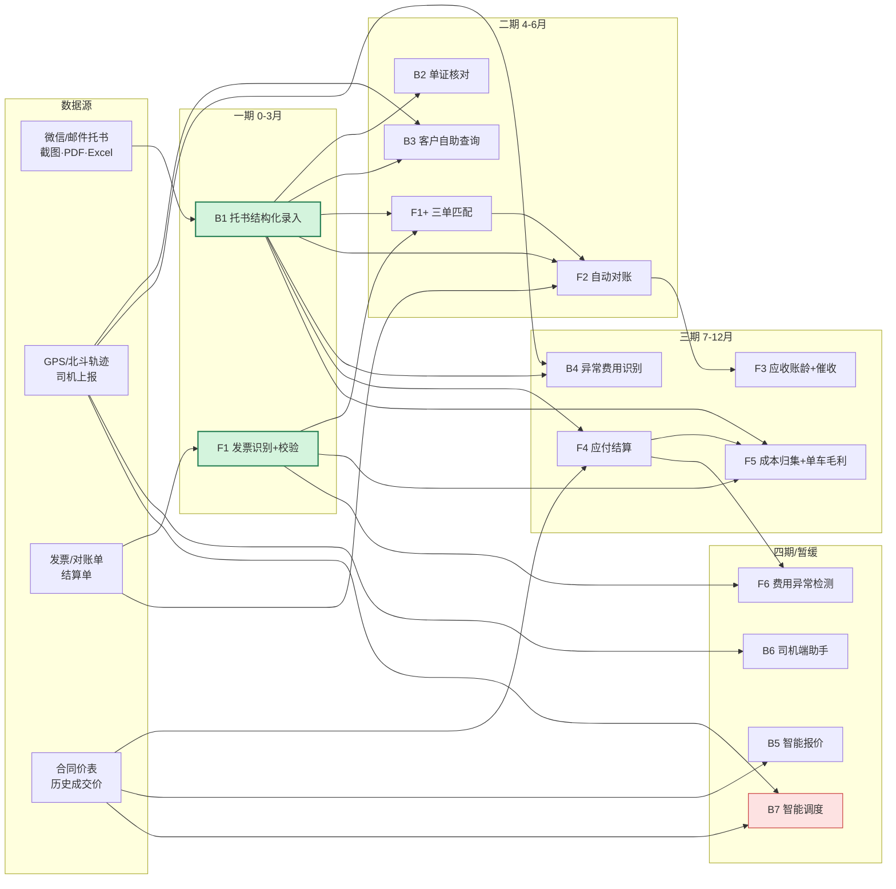

# 机会地图 · 港口集卡（拖车）运输
## 业务 × 财务 双域机会点与实施顺序

> 版本 v0.2 ｜ 用途：售前会客一页图 ｜ 目标客户画像：自有车辆 ≥50 台的集卡/拖车/货代企业
>
> **数据来源**
> - 业务侧：`../港口集卡运输AI可行性评估.md` v0.1 第 4 节场景矩阵、第 5 节投入产出测算
> - 财务侧：本次新增推演（**无客户基线，全部为量级估算**）
>
> **口径声明**：本图所有金额为"行业经验区间 + 假设推演"，用于判断**优先级与量级**，不可直接作为预算依据。
> 标注 `待校准` 的项，必须用客户真实基线（工时、单量、漏收率、账龄）替换后才能进方案。

---

## 0.1 客户参数（会客前必须填，缺一项则对应结论不可用）

| # | 参数 | 当前假设值 | 影响哪一部分 | 未填时的处理 |
|---|---|---|---|---|
| C1 | **自有车辆数** | 100 台 | §4 全部 ROI、§2 B1/F2 收益 | 只讲"每 100 台约 95–185 万/年"，不报绝对值 |
| C2 | **是否含货运代理业务**（报关/订舱/提单） | 否（纯集卡） | §2 是否新增单证类机会点（报关单核对、提单确认） | 按纯集卡讲，代理业务留作二期 |
| C3 | **是否已有 TMS**（或纯 Excel/微信） | 有 TMS | §2 B1 工期、B2/B3/F2 可行性；§5 B1 前置条件 | 无 TMS → B1 仍可做（输出 CSV），但 B3/F2 降级为"暂缓" |

> 填写方式：会客前从客户公开信息或第一次沟通中确认；会后连同实测值一起回写到本表。
> **这三个参数决定了本图是"通用模板"还是"客户方案"，对外报价前必须填满。**

---

## 0. 一页结论（给老板看的版本）

### 三句话

1. **你这两块的 AI 不是两条线，是一条链。** 财务的对账、毛利、应收之所以算不清，根子在业务数据还躺在微信里。所以财务的 AI 上限，由业务数据结构化的程度决定。
2. **先做 2 个点，3 个月能算出钱。** 托书自动录入（业务）+ 发票识别校验（财务）。这两个不依赖任何前置系统，也不需要改一线流程。
3. **其余 11 个点，等这两个把数据垫起来再做，ROI 会高一个档。** 反过来先做调度、先做经营分析，一定烂尾。

### 这条链长什么样

```
 ① 接单          ② 单证        ③ 在途执行      ④ 结算收款      ⑤ 成本核算      ⑥ 经营决策
 微信托书  →  订单/派车  →  提箱/装柜  →  运单/对账  →  发票/成本  →  报价/调度
   │              │              │               │              │              │
  B1 ★★★★☆      B2 ★★★★★     B3 ★★★★★      F1 ★★★★★     F5 ★★★☆☆     B5 ★★★☆☆
 托书结构化     单证核对       客户自助查询    发票识别       成本归集      智能报价
                                B6 ★★★☆☆      F2 ★★★★★     单车毛利       B7 ★★☆☆☆
                               司机助手        自动对账                     智能调度
                                B4 ★★★★☆      F3 ★★★★☆
                               异常费用        应收催收
                                               F4 ★★★★☆
                                               应付结算
                                               F6 ★★★☆☆
                                               费用异常检测
```

**关键读法：箭头方向就是依赖方向。** ① 不通，②～⑥ 全部悬空。这是本图最重要的一句话。

### 第一期建议（0–3 个月）

| 做 | 为什么是它 |
|---|---|
| **B1 托书 → 订单结构化录入** | 唯一一个**不依赖任何前置数据**的场景，1 个月可见效 |
| **F1 发票识别 + 字段校验** | 财务侧唯一不依赖运单数据的单点，且是后续"三单匹配"的前置 |

**验收线**：B1 字段级准确率 ≥95%、人工修正 ≤1 分钟/单；F1 关键字段（金额/税额/税号）准确率 ≥98%、单张复核 ≤30 秒。

---

## 1. 业务侧机会点（7 个）

| 编号 | 机会点 | 价值 | 可行性 | 依赖 | ROI 口径 | 前置条件 | 期次 |
|---|---|---|---|---|---|---|---|
| **B1** | 托书/订单结构化录入 | 高 | 高 | 无 | 单证岗工时释放 → **人均处理单量 +X%** | 有真实托书样本 ≥200 份；能拿到微信/邮件原始格式 | **一期** |
| **B2** | 单证核对（箱号/封号/重量/报关） | 高 | 高 | B1 | 错箱/滞港罚款减少 | 订单已结构化；有历史差错记录 | 二期 |
| **B3** | 客户自助查询（到哪了/几时到/多少钱） | 中 | 高 | B1 + 轨迹 | 客服电话量下降 % | 有 TMS 或可导出的运单数据；有 GPS | 二期 |
| **B4** | 异常费用识别与追收 | 高 | 中高 | B1 + 在途事件 | 漏收率 1.5% → 0.8% | 有压车/等候/改单的判定规则或历史单据 | 三期 |
| **B5** | 智能报价 | 中 | 中 | 历史价目 | 报价效率 + 毛利一致性 | 有 ≥12 个月成交价记录 | 四期 |
| **B6** | 司机端助手（语音派单/异常上报） | 中 | 中 | 移动端 | 调度沟通工时 | 司机愿意用（组织条件，非技术） | 四期 |
| **B7** | 智能调度/配载优化 | 高 | **低** | 轨迹 + 货源池 | 空驶率 35%→31% | ①有稳定货源池 ②司机接受系统派单 | **暂缓** |

> **B7 为什么排最后**：它不是算法问题，是货源和司机意愿问题。AI 只能优化匹配，不能创造回程货。没有货源池，优化出来的方案司机也不执行。这一条建议当面讲，是专业度最强的一击。

---

## 2. 财务侧机会点（6 个）

| 编号 | 机会点 | 价值 | 可行性 | 依赖 | ROI 口径 | 前置条件 | 期次 |
|---|---|---|---|---|---|---|---|
| **F1** | 发票识别 + 字段校验 | 高 | 高 | 无（识别层） | 发票录入/审核工时；错票退回率 | ✅ **已实现**（税号校验位 + 金额勾稽）；认证/勾选未做 | **一期** |
| **F2** | 自动对账（客户/货代对账单 vs 运单） | 高 | 高 | B1 + 对账单 | 对账人工工时（**人 × 天/月**）`待校准` | 能拿到近 6 个月对账单；运单已结构化 | 二期 |
| **F3** | 应收账龄 + 逾期催收 | 高 | 中高 | F2 | 回款天数提前；坏账率下降 | 有应收台账；账龄口径统一 | 三期 |
| **F4** | 应付结算（外协车队/司机运费） | 中高 | 中高 | B1 + 合同价 | 结算工时；多付/少付差错 | 有合同价表；结算周期明确 | 三期 |
| **F5** | 成本归集 + 单车毛利 | 中高 | 中 | F1 + F4 + 运单 | **不是省钱，是决策质量**（哪条线赚钱） | 费用科目统一；油/路桥/维修可归集 | 三期 |
| **F6** | 费用异常检测（重复报销/异常油耗） | 中 | 中 | 历史费用 | 异常支出挽回 | ≥6 个月干净的费用历史 | 四期 |

> **财务侧的三个特殊约束（必须在会上讲清）**
> 1. **合规高于效率**：发票、税务、审计场景必须有"人工复核 + 全量留痕 + 可追溯"，AI 只能出草稿。这一条正好是交付平台的原生能力（审计日志）。
> 2. **F1 一期只做"识别 + 校验"，不做"三单匹配"。** 三单匹配需要运单，属于二期。一期承诺三单匹配 = 给自己挖坑。
> 3. **财务侧 ROI 全部 `待校准`。** 没有客户的对账工时基线，任何数字都是编的。第一次见面只给公式，不给结论。

---

## 3. 依赖关系：为什么是这个顺序

```
B1 托书结构化 ──┬──→ B2 单证核对
（唯一根节点）  ├──→ B3 客户查询（+轨迹）
                ├──→ B4 异常费用（+在途事件）
                ├──→ F1 三单匹配（+发票，二期扩展）
                ├──→ F2 自动对账（+对账单）
                ├──→ F4 应付结算（+合同价）
                └──→ F5 成本/毛利（+F1+F4）

F1 发票识别 ──→ F1 三单匹配 ──→ F5 成本归集
                             ↘ F2 对账 ──→ F3 应收催收
```

### 三条硬规则

| 规则 | 含义 | 违反的后果 |
|---|---|---|
| **R1 根节点优先** | B1 是唯一不依赖前置数据的点，必须第一期 | 先做别的 → 全部悬空，3 个月后什么都算不出 |
| **R2 财务后置** | 财务 6 个点里 5 个依赖 B1 或其下游 | 先做财务 → 先花 3 个月补业务数据的窟窿，两头空 |
| **R3 单点验证** | 每期最多 2 个点，且必须能独立算出钱 | 铺开 6 个点 → 每个 30%，无一可算账 → 二期预算批不下来 |

### 为什么"业务 + 财务一起上"是客户最容易犯的错

客户说"两块都要"，心里想的是"一次投入、全面见效"。但真实结果是：

- 财务系统里已有的数据是**结果数据**（收入、成本、余额），不是**过程数据**（哪一单、哪台车、为什么亏）
- 过程数据不在系统里，在微信和司机脑子里 → 只能靠 B1 抽出来
- 所以财务 AI 的输入质量 **= B1 的完成度**

**这句话讲出来，客户会立刻明白为什么不能同时做。** 这是本图的核心说服力，不是技术细节。

---

## 4. 三期路线与 ROI

> 全部按 **100 台车 / 年营收 4,800 万 / 毛利率 10–18%** 假设推演。
> 收益表述统一用"人均处理单量提升 X%"，不用"省 X 个人"——后者在大多数公司不会真发生，也过不了内部评审（见可行性评估 §5.4）。

| 期次 | 时间 | 机会点 | 年化收益 | 置信度 |
|---|---|---|---|---|
| **一期** | 0–3 月 | B1 + F1（识别层） | **25–45 万** | 高 |
| **二期** | 4–6 月 | B2 + B3 + F1（三单匹配）+ F2 | **40–80 万** | 中高 |
| **三期** | 7–12 月 | B4 + F3 + F4 + F5 | **30–60 万** | 中 |
| 四期/暂缓 | 12 月+ | B5 + B6 + B7 + F6 | 视数据积累 | 低 |
| | | **合计** | **95–185 万（中值 ≈ 130 万）** | |

**与可行性评估 §5.1 的一致性**：该文档给出 81–180 万。本图拆分后上沿略高，是因为把财务侧 4 个点也纳入了测算——**但财务侧数字全部未校准**，对客户汇报时应取下沿（95 万）保守表述。

> **⚠️ 不要按台数线性缩放。** 模拟演练发现：80 台车的客户单证只有 2 人（不是 3 人），
> 收益分子变小，但系统投入不按台数等比例下降，**回本周期会明显拉长**（实测约 15–22 个月，而非 12–18 个月）。
> 台数 <80 家时，必须先问清单证人数和日均票数，再重算，不能套系数。

### 一期为什么敢报 25–45 万

| 项 | 机制 | 金额 |
|---|---|---|
| B1 | 单证岗 3 人 × 60% 工作量释放（不裁人，转做客户维护/异常处理） | 18–30 万 |
| F1 | 发票录入与初审工时（100 台车月度发票量级下） | 5–12 万 `待校准` |
| 叠加 | B1 产出的结构化数据直接降低 F1 的匹配难度 | — |

---

## 5. 前置条件 = 要问客户的问题

**本图的真正用途：把"缺什么"变成"问什么"。** 任何一个前置条件答"没有"，对应机会点当场降级。

| 机会点 | 一句话必问 | 答"没有"时的处理 |
|---|---|---|
| B1 | 微信/QQ 来的托书占订单多少？能给 200 份样本吗？ | 样本 <50 份 → 只做规则模板，不上模型 |
| B2 | 一年因错箱/错单被罚多少钱？ | 无记录 → 先记录 3 个月，不立项 |
| B3 | 客服一天接多少"到哪了"的电话？ | 说不清 → 无基线，不做 |
| B4 | 压车费/等候费一年大概多少？漏收过吗？ | 说不清 → 先做费用台账 |
| B7 | 有稳定的回程货源池吗？司机接受系统派单吗？ | 没有 → **当面建议暂缓** |
| F1 | 发票是纸质/电子/全电？用什么财务软件？ | 全纸质且量大 → 收益高但需扫描件，工期 +2 周 |
| F2 | 对账单谁做？每月多少份？做一次多久？ | 说不清 → **对账场景直接砍掉** |
| F3 | 应收账龄现在怎么管？逾期率多少？ | Excel 且口径乱 → 先统一口径 |
| F4 | 外协车队怎么结算？有合同价表吗？ | 口头结算 → 不做，先建规则 |
| F5 | 费用科目统一吗？油/路桥/维修能归到单车吗？ | 归不到 → 只能做公司级，不做单车毛利 |
| F6 | 有 6 个月以上干净的费用历史吗？ | 没有 → 推迟 |

> **最值钱的是 F2 那一问。** 如果对账是"2 个人做 5 天/月"，ROI 当场能算出来，客户自己会算；如果说"财务说不清"，说明这块连基线都没有，做不了——而这恰恰是你比他专业的地方。

---

## 6. 明确不做的事（会上主动说）

主动划边界，比承诺更多更能拿到信任。

| 不做 | 原因 |
|---|---|
| 一上来做智能调度 / 配载优化 | 依赖货源池与司机意愿，12 个月内不具备条件 |
| 一上来做经营分析大屏 | 没有结构化过程数据，大屏只是把 Excel 搬到墙上 |
| 替客户裁人或承诺"省 X 个人" | 不会发生，且会毁掉内部推动力 |
| AI 直接对外发单 / 直接付款 | 幻觉成本不可接受，必须人工确认 |
| 一次性替换现有 TMS / 财务软件 | 本方案的定位是"上层增强"，不是替代 |
| 第一期就接客户系统 | 接口风险会把 3 个月拖成 9 个月 |

---

## 7. 本图在会客时怎么讲

| 时机 | 讲哪一块 | 目的 |
|---|---|---|
| 开场 5 分钟 | §0 的三句话 + 价值链图 | 建立"我提前替你想过"的位置 |
| 5–15 分钟 | §5 的提问表，现场勾选 | **拿到真实基线**，同时演示诊断能力 |
| 15–25 分钟 | §3 的"为什么财务不能先做" | 拉开与通用 AI 供应商的差距 |
| 25–35 分钟 | §4 路线图 + 用他的规模现场重算 | 让他自己得出结论，不是你推销 |
| 35–45 分钟 | §6 不做什么 + 一期验收线 | 收窄范围，换取"3 个月见数"的承诺 |
| 收尾 | 要两样东西：**200 份托书样本 + 1 名内部 owner** | 这才是本次会面的真实成交物 |

> 收尾话术：**"今天不谈合同。我要两样东西：200 份真实托书，和你们内部一个能拍板的人。给我这两样，3 周后我带一份用你们数据跑出来的准确率报告回来。"**

---

## 附录 A · 完整依赖图



---

## 附录 B · 假设与口径

| 项 | 假设值 | 来源 / 状态 |
|---|---|---|
| 自有车辆数 | 100 台 | 假设，需客户确认 |
| 单车月营收 | 4.0 万元（区间 3–5 万） | 可行性评估 §2.2 |
| 年营收 | 4,800 万元 | 推算 |
| 毛利率 / 净利率 | 10–18% / 3–6% | 可行性评估 §2.2 |
| 空驶率 | 35%（行业 30–40%） | 可行性评估 §2.3 |
| 异常费用漏收率 | 1.5% → 0.8% | 可行性评估 §5.1 |
| 单证岗人数 | 3 人 | 假设，需客户确认 |
| 对账人工 | 人 × 天/月 | **待校准 —— 客户必答** |
| 发票月度张数 | 未定 | **待校准 —— 客户必答** |
| 财务侧全部 ROI | — | **待校准，不得对外引用具体金额** |

### 一句话口径

> 业务侧数字可以对外讲量级，**财务侧数字只能讲公式**。因为财务的基线在客户手里，不在行业报告里。

---

## 变更记录

| 版本 | 日期 | 变更 |
|---|---|---|
| v0.1 | 2026-11-01 | 初版：业务 7 点 + 财务 6 点，三期路线，前置条件表 |
| v0.2 | 2026-11-01 | 新增 §0.1 客户参数待填表（C1 车辆数 / C2 是否含货代 / C3 是否已有 TMS），并说明各参数影响范围与未填时的降级口径 |
