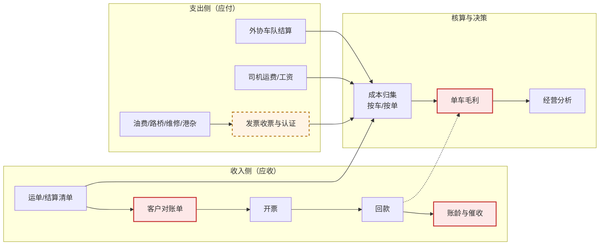
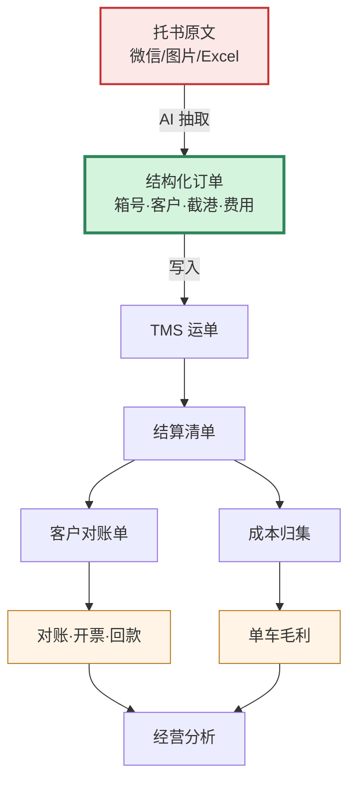

# 业务与财务流程全图

> 目的：看清 **AI 到底在哪些节点上真的起了作用、做了什么、产出什么**。
> 图例：🟩 已实现并有实测数据 ｜ 🟧 可做但未实现 ｜ 🟥 当前最大痛点（AI 帮不上或还没帮）
>
> 一句话结论先说：**目前只有"托书解析"这一个节点是完整跑通的**，
> 但它恰好是所有下游数据的总闸门——它不通，后面全通不了。

---

## 一、业务主线（从接到一票货到运单完成）

```mermaid
flowchart LR
  subgraph 接单["① 接单"]
    A1["客户下单<br/>微信/邮件/电话"]
    A2["报价与接单"]
    A3["托书解析"]
    A4["订单录入 TMS"]
  end

  subgraph 单证["② 单证"]
    B1["单证核对<br/>箱号/封号/重量"]
    B2["派车与调箱"]
  end

  subgraph 执行["③ 执行"]
    C1["提空箱 EIR"]
    C2["工厂装柜"]
    C3["重箱进港"]
    C4["报关与放行"]
    C5["提单确认"]
    C6["在途异常<br/>压车/等候/改单"]
  end

  subgraph 收尾["④ 收尾"]
    D1["运单完成"]
    D2["结算清单"]
  end

  A1 --> A2 --> A3 --> A4 --> B1 --> B2 --> C1 --> C2 --> C3 --> C4 --> C5 --> C6 --> D1 --> D2
  C6 -.->|异常费用| D2

  classDef ai fill:#d4f4dd,stroke:#2f855a,stroke-width:2px
  classDef plan fill:#fff4e5,stroke:#b7791f,stroke-width:2px,stroke-dasharray:5 5
  classDef pain fill:#fde8e8,stroke:#c53030,stroke-width:2px

  class A3 ai
  class B1,C6 plan
  class A1 pain
```

### 逐节点说明

| 节点 | 人工原来怎么做 | AI 做什么（具体） | 得到什么结果 | 状态 |
|---|---|---|---|---|
| **A1 客户下单** | 微信/QQ 发一段话、一张截图、一个 Excel | 不做生成，只做**入口收敛**：企微机器人/H5 把所有来单先落库 | 每票有据可查；后续能算"绕过率" | 🟩 已实现 |
| **A3 托书解析** | 看原文，手工敲进 TMS，**约 3 分钟/票** | ① OCR 识别图片/PDF ② 抽 20 个字段并给置信度 ③ ISO 6346 箱号校验位 ④ 截港时间解析与过期判断 ⑤ 字段名容错（`箱→第`）⑥ 多票切分 ⑦ 改单 diff | **40 秒/票**；字段级 **92–94%**；箱号录错**当场拦下** | 🟩 已实现（核心） |
| **B1 单证核对** | 肉眼比对箱号、封号、重量、截港 | 规则交叉校验：箱号校验位、箱量与箱号数一致性、封号格式、装柜时间晚于截港 | 拦住 4 类高频错误 | 🟨 部分（只做规则，没做跨单据比对） |
| **B2 派车调箱** | 调度凭经验排 | — | — | 🟥 不做（依赖货源池与司机意愿） |
| **C1–C5 执行** | 司机、报关行、码头各自作业 | — | — | 🟥 不在范围内 |
| **C6 在途异常** | 调度记在本子/Excel，月底靠回忆补 | 设想：从聊天记录/司机上报里抽事件并生成待追收费用 | — | 🟧 未实现 |
| **D1 运单完成** | 手工结单 | — | — | — |
| **D2 结算清单** | 单证/财务手工汇总 | — | — | — |

---

## 二、财务主线（从运单到毛利）

### 逐节点说明

| 节点 | 人工原来怎么做 | AI 能做什么 | 实际结果 | 状态 |
|---|---|---|---|---|
| **R2 客户对账单** | **2 人 × 5 天/月**，Excel 逐条对 | 对账单 vs 运单自动匹配 + 差异定位 | 目标：2 人 5 天 → 半天 | 🟥 **当前最大痛点，未实现** |
| **R5 账龄与催收** | Excel 台账，逾期靠人记得 | 账龄分析 + 逾期预警 + 催收话术 | — | 🟧 未实现 |
| **P4 发票收票** | **4 分钟/张**，手工录入 | OCR + 字段抽取 + 税号/金额/税率校验 | 目标 1.5 分钟/张 | 🟧 未实现（原计划 04b） |
| **P1 外协结算** | 按趟对合同价，手工算 | 运单 × 合同价自动核对 | — | 🟧 未实现 |
| **S1 成本归集** | 费用归不到车，只能算公司级 | 发票按科目/车号归类 | 决定能不能算单车毛利 | 🟥 依赖 P4 |
| **S2 单车毛利** | **算不出来** | — | — | 🟥 依赖 S1 |

> **财务侧的真实结论**：六个高价值场景里，**目前一个都没有实现**。
> 不是技术不行，是**它们全部依赖业务侧先把数据结构化**——而那是 A3 的活。

---

## 三、价值传导链（为什么只做一个点也要先做它）

**这张图是全部论证的核心：**

- 只有 **X1 → X2** 这一段是 AI 真正在做的事（把非结构化变成结构化）
- 但它决定了 X3 之后**每一段的数据质量**
- X7（对账）和 X8（单车毛利）之所以"算不清"，根子在 X1 没做好

---

## 四、AI 在每个细节上到底做了什么（技术视角）

| 能力 | 触发条件 | 具体动作 | 输出 |
|---|---|---|---|
| 图片/PDF 识别 | 上传截图、扫描件 | 纠偏 + 去噪 + 二值化多版本，规则裁决选优 | 文本 + 版面行 |
| 字段抽取 | 任意托书文本 | 规则通道（格式字段）+ 模型通道（语义字段），只补空不覆盖 | 20 字段 + 置信度 |
| 箱号校验 | 抽到 4 字母 + 7 数字 | ISO 6346 校验位计算 | 通过/拦截 |
| 截港判断 | 抽到时间 | 与当前时间比较 | 已过期（阻断）/ 24h 内（提醒） |
| 字段名容错 | 键名与标准不符 | 标签相似度 ≥0.6 且值形态校验通过 | 补出漏抽字段 |
| 多票切分 | 出现 ≥2 个单号 | 编号列表 / 单号行 / 空行 三级切分 | N 张独立草稿 |
| 改单识别 | 出现"原单/有变/改成" | 检索原单 → 增删改语义 diff | 差异列表 + 合并结果 |
| 分级审批 | 每次解析后 | 按"高代价字段"确定性分四档 | auto / single / double / blocked |
| 绕过率 | 每次入口捕获 | 未确认单 ÷ 入口来单 | 百分比 + 20% 告警 |
| 风险模拟 | 人工触发 | 置信度分布 × 罚款均值 + Laplace 平滑 | 取消人工的月损失 |
| 弱金标评测 | 有 TMS 历史 | TMS 当答案 + 10% 抽检校正 | 准确率 + 95% 置信区间 |

### 实测数字（不是承诺）

| 指标 | 数值 | 来源 |
|---|---|---|
| 单票耗时 | 3 分钟 → **40 秒** | 模拟一天 18 单 |
| 字段级准确率 | **92–94%** | 扫描件模拟 |
| 自动通过率 | **66.7%** | 同上 |
| 箱号录入错误 | **100% 拦截** | ISO 6346 |
| 修正率 | **0.4%** | 同上 |
| OCR 单页耗时 | **2.2–2.6 秒** | 400 页推算 82 分钟 |

---

## 五、现状盘点

| 分类 | 数量 | 说明 |
|---|---|---|
| 🟩 已实现且有数据 | **1** | 托书解析（含 7 个子能力） |
| 🟨 部分实现 | **1** | 单证核对（只做规则校验） |
| 🟧 可做但未做 | **5** | 发票识别、自动对账、账龄催收、异常费用、外协结算 |
| 🟥 痛点且依赖前置 | **3** | 对账、成本归集、单车毛利 |
| ⛔ 明确不做 | **2** | 智能调度、司机端 |

---

## 六、给客户讲这张图的三句话

1. **"你现在最痛的是对账和毛利，但它们的根子不在财务，在微信里的那段托书。"**
2. **"我不先动财务，因为财务的账是从运单来的，运单是从托书来的。"**
3. **"所以第一期只做一件事：把托书变成数据。做完之后，对账才有可能自动化。"**

---

## 七、一句话总结

> **AI 目前只在"读"这件事上真正发挥作用——把一段人写的、乱的、图片的文字，读成机器能算的结构化数据。**
>
> **但正是这一步，决定了后面所有环节能不能算账。**
