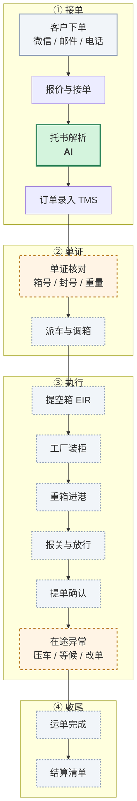
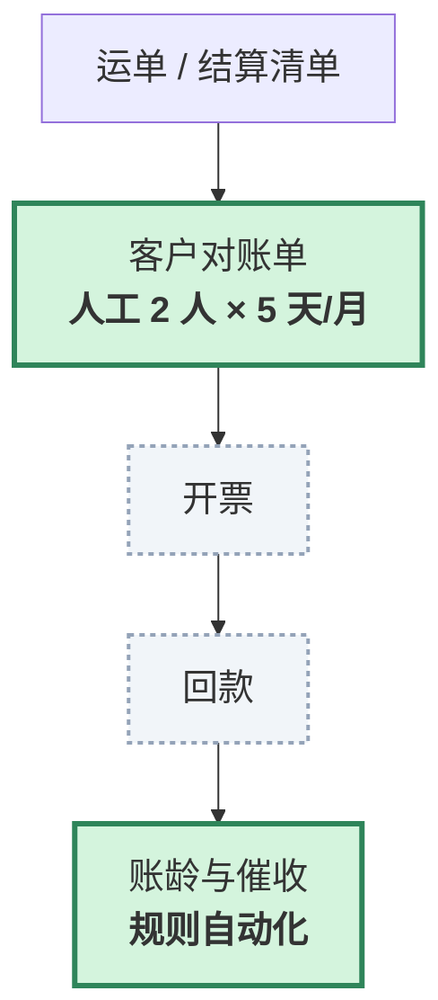
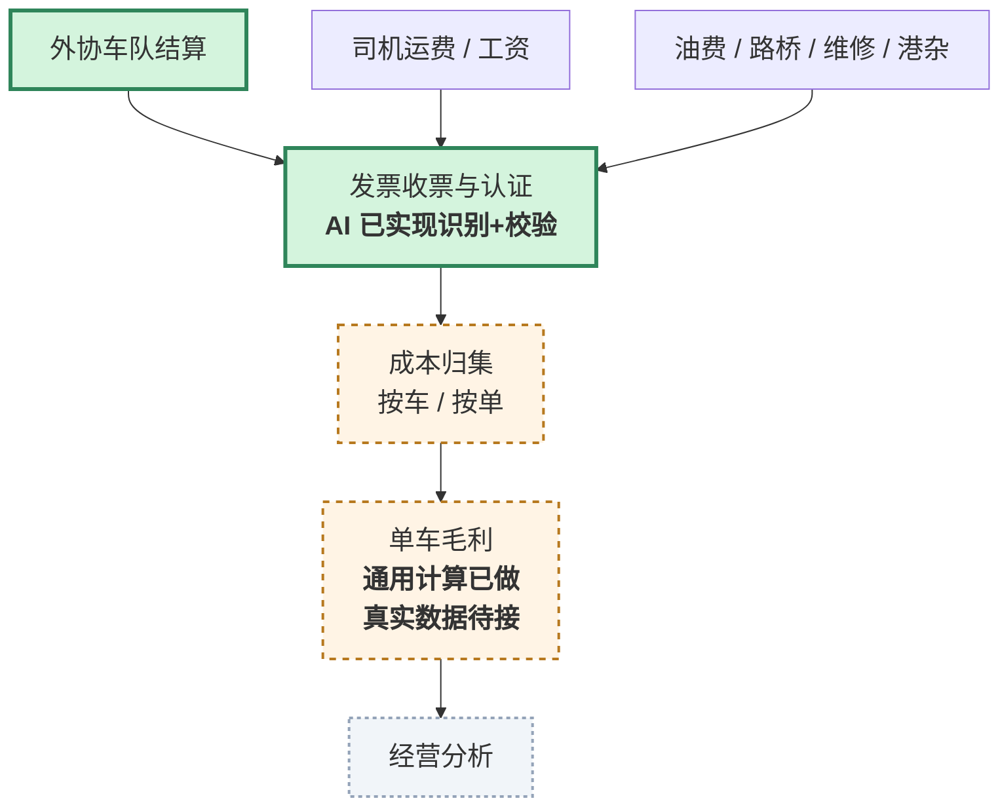
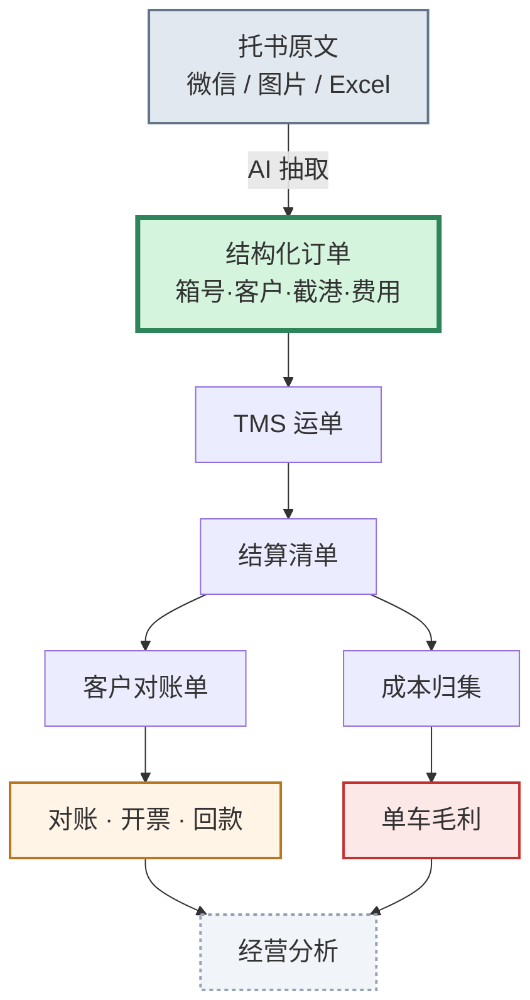

# 业务与财务流程全图

> 目的：看清 **AI 到底在哪些节点上真的起了作用、做了什么、产出什么**。
> 图例：🟩 已实现并有实测数据 ｜ 🟨 部分实现 ｜ 🟧 可做但未实现 ｜ 🟥 被前置条件阻塞（不是 AI 不会） ｜ ⛔ 本期范围外（灰色虚线） ｜ ⚪ 输入源 / 非 AI 节点（灰色实线）
>
> 一句话结论：**大模型真正介入的是托书解析与发票识别**；对账、账龄、外协结算、异常费用是规则自动化；
> 仍红的是成本归集与单车毛利，卡在客户侧费用数据源（油卡/路桥/维修）和运单映射，不是模型能力。

---

## 一、业务主线（从接到一票货到运单完成）

### 逐节点说明

| 节点 | 人工原来怎么做 | 系统做什么（具体） | 实现方式 | 得到什么结果 | 状态 |
|---|---|---|---|---|---|
| **A1 客户下单** | 微信/QQ 发一段话、一张截图、一个 Excel | 不做生成，只做**入口收敛**：企微机器人/H5 把所有来单先落库 | 入口/集成（非模型） | 每票有据可查；后续能算"绕过率" | 🟩 已实现（入口捕获；绕过率仍需运营） |
| **A3 托书解析** | 看原文，手工敲进 TMS，**约 3 分钟/票** | ① OCR 识别图片/PDF ② 抽 20 个字段并给置信度 ③ ISO 6346 箱号校验位 ④ 截港时间解析与过期判断 ⑤ 字段名容错（`箱→第`）⑥ 多票切分 ⑦ 改单 diff | OCR + 大模型 + 规则 | **40 秒/票**；字段级 **92–94%**；箱号录错**当场拦下** | 🟩 已实现（核心） |
| **B1 单证核对** | 肉眼比对箱号、封号、重量、截港 | 规则交叉校验：箱号校验位、箱量与箱号数一致性、封号格式、装柜时间晚于截港 | 规则 | 拦住 4 类高频错误 | 🟨 部分（只做规则，没做跨单据比对） |
| **B2 派车调箱** | 调度凭经验排 | — | — | — | ⛔ 本期范围外（依赖货源池与司机意愿） |
| **C1–C5 执行** | 司机、报关行、码头各自作业 | — | — | — | ⛔ 本期范围外（物理执行 + 外部系统） |
| **C6 在途异常** | 调度记在本子/Excel，月底靠回忆补 | 费用侧已做结构异常检查（`/fees`）；从聊天/司机上报抽在途事件仍未做 | 规则（费用异常）；事件抽取待补大模型 | 重复收费、算错、离群能拦 | 🟧 部分（费用结构已实现） |
| **D1 运单完成** | 手工结单 | — | — | — | ⛔ 本期范围外（人工/TMS） |
| **D2 结算清单** | 单证/财务手工汇总 | — | — | — | ⛔ 本期范围外（人工/财务） |

---

## 二、财务主线（从运单到毛利）

**图 2 · 应收链路（收入侧）**

**图 3 · 应付与核算（支出侧）**

### 逐节点说明

| 节点 | 人工原来怎么做 | 系统能做什么 | 实现方式 | 实际结果 | 状态 |
|---|---|---|---|---|---|
| **R2 客户对账单** | **2 人 × 5 天/月**，Excel 逐条对 | 单票三单匹配 + 账单级双向对账（四类差异定位 + 总额比对） | 规则/匹配算法 | 单票秒级；整张对账单几秒出差异表 | 🟩 **已实现** |
| **R5 账龄与催收** | Excel 台账，逾期靠人记得 | 四档账龄 + 客户风险分级 + 催收话术 | 规则/算法 | 自动出「谁欠最久、该打给谁」 | 🟩 **已实现** |
| **P4 发票收票** | **4 分钟/张**，手工录入 | OCR + 字段抽取 + 税号校验位 + 金额勾稽 + 税率校验 | OCR + 大模型 + 规则 | 关键字段 10/10，结构化票 27ms | 🟩 **已实现**（认证/勾选未做） |
| **P1 外协结算** | 按趟对合同价，手工算 | 合同价 × 数量自动核对，多付/少付/无价三态 | 规则 | 一次核对整张结算单 | 🟩 **已实现** |
| **S1 成本归集** | 费用归不到车，只能算公司级 | 单号优先 → 车辆+日期±N 天 → 待分摊；`/margin` | 规则 | 通用计算已跑通；真实数据仍缺 | 🟨 通用已做，真实费用数据待客户 |
| **S2 单车毛利** | **算不出来** | 订单/车辆毛利、低毛利/亏损、待分摊 | 规则 | 通用页可演示；真实口径待客户 | 🟨 通用已做，真实数据待接 |

> **R5 账龄与催收的实现边界**：这里的“AI”是规则/算法自动化，不是大模型自由生成——
> 分档、客户风险分级、排序、催收话术模板都是确定性的，可审计、可复现；
> 可选的 AI 润色只改措辞，金额/天数由规则注入，人工核对后才复制，默认关闭；
> 它不自动发消息、不打电话、不替客户做法律判断。

> **S1 成本归集为什么还不能给客户结论**：通用计算已经能跑（`/margin`），但真实口径还缺四件事——
> ① 费用数据分散在油卡/路桥/维修/港杂/工资/外协各一套；
> ② 科目口径不统一；
> ③ 费用行缺车号/运单号，归不到单车/单票；
> ④ 运单/TMS 的实际车辆与收入数据未打通。
> 客户能导出三类费用明细 + 运单清单后，代码约 2–3 天；在此之前只能做公司级分析，直接做单车毛利会失真。

> **财务侧的真实结论**：六个高价值场景里，发票、对账、账龄、外协结算已经跑通；
> 仍红的是**成本归集与单车毛利**——卡在客户侧费用数据源（油卡/路桥/维修）和运单映射，不是模型能力。

---

## 二·补 哪些节点真正用了大模型

| 节点 | 实现方式 | 说明 |
|---|---|---|
| A3 托书解析 | OCR + 大模型 + 规则 | 模型理解语义字段，规则裁决箱号/时间等强格式字段 |
| P4 发票识别/校验 | OCR + 大模型 + 规则 | 模型抽语义字段，规则做税号/金额/税率校验 |
| R2 客户对账单 | 规则/匹配算法 | 确定性比对，不做生成 |
| R5 账龄与催收 | 规则/算法 | 分档、分级、排序、话术模板，可审计可复现 |
| P1 外协结算 | 规则 | 合同价 × 数量，多付/少付/无价 |
| C6 异常费用 | 规则 | 重复/算术/未知/离群 |
| S1/S2 成本与毛利 | 待客户数据 | 不是模型问题，缺费用数据源与运单映射 |

> 结论：**大模型负责“读”，规则负责“查/算”**。财务数字必须可审计，不能让模型自由生成金额、账龄或法律结论。

---

## 三、价值传导链（为什么只做一个点也要先做它）

**图 4 · 价值传导链**

**这张图是全部论证的核心：**

- 只有 **X1 → X2** 这一段是 AI 真正在做的事（把非结构化变成结构化）
- 但它决定了 X3 之后**每一段的数据质量**
- X7（对账）和 X8（单车毛利）之所以"算不清"，根子在 X1 没做好

---

## 四、AI 在每个细节上到底做了什么（技术视角）

| 能力 | 触发条件 | 具体动作 | 输出 |
|---|---|---|---|
| 图片/PDF 识别 | 上传截图、扫描件 | 纠偏 + 去噪 + 二值化多版本，规则裁决选优 | 文本 + 版面行 |
| 字段抽取 | 任意托书文本 | 规则通道（格式字段）+ 模型通道（语义字段），只补空不覆盖 | 20 字段 + 置信度 |
| 箱号校验 | 抽到 4 字母 + 7 数字 | ISO 6346 校验位计算 | 通过/拦截 |
| 截港判断 | 抽到时间 | 与当前时间比较 | 已过期（阻断）/ 24h 内（提醒） |
| 字段名容错 | 键名与标准不符 | 标签相似度 ≥0.6 且值形态校验通过 | 补出漏抽字段 |
| 多票切分 | 出现 ≥2 个单号 | 编号列表 / 单号行 / 空行 三级切分 | N 张独立草稿 |
| 改单识别 | 出现"原单/有变/改成" | 检索原单 → 增删改语义 diff | 差异列表 + 合并结果 |
| 分级审批 | 每次解析后 | 按"高代价字段"确定性分四档 | auto / single / double / blocked |
| 绕过率 | 每次入口捕获 | 未确认单 ÷ 入口来单 | 百分比 + 20% 告警 |
| 风险模拟 | 人工触发 | 置信度分布 × 罚款均值 + Laplace 平滑 | 取消人工的月损失 |
| 弱金标评测 | 有 TMS 历史 | TMS 当答案 + 10% 抽检校正 | 准确率 + 95% 置信区间 |

### 实测数字（不是承诺）

| 指标 | 数值 | 来源 |
|---|---|---|
| 单票耗时 | 3 分钟 → **40 秒** | 模拟一天 18 单 |
| 字段级准确率 | **92–94%** | 扫描件模拟 |
| 自动通过率 | **66.7%** | 同上 |
| 箱号录入错误 | **100% 拦截** | ISO 6346 |
| 修正率 | **0.4%** | 同上 |
| OCR 单页耗时 | **2.2–2.6 秒** | 400 页推算 82 分钟 |

---

## 五、现状盘点

| 分类 | 数量 | 说明 |
|---|---|---|
| 🟩 已实现且有数据 | **6** | 托书解析、发票识别与校验、自动对账、账龄与催收、外协结算、异常费用识别 |
| 🟨 部分实现 | **1** | 单证核对（只做规则校验） |
| 🟧 可做但未做 | **1** | 在途事件抽取（费用结构异常已实现） |
| 🟥 被前置条件阻塞 | **2** | 成本归集（缺费用数据源）、单车毛利（依赖成本归集） |
| ⛔ 本期范围外 | **8** | 派车调箱、提箱/装柜/进港/报关/提单、运单完成/结算清单 |
| ⛔ 明确不做 | **2** | 智能调度、司机端 |

---

## 六、给客户讲这张图的三句话

1. **"你现在最痛的是对账和毛利，但它们的根子不在财务，在微信里的那段托书。"**
2. **"我不先动财务，因为财务的账是从运单来的，运单是从托书来的。"**
3. **"所以第一期只做一件事：把托书变成数据。做完之后，对账才有可能自动化。"**

---

## 七、一句话总结

> **大模型负责“读”（托书/发票），规则负责“查/算”（校验/对账/账龄/结算）。**
>
> **还没通的是需要客户费用数据源的“成本归集/单车毛利”；这一步决定了经营分析能不能真正落地。**
