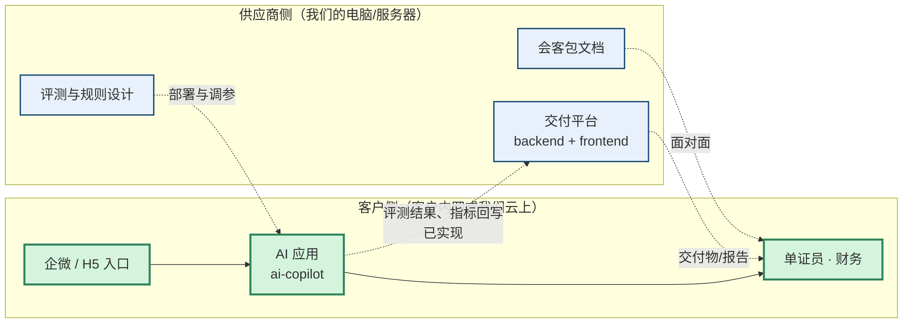

# 系统边界与落地清单

> 回答两个问题：
> 1. **这是一个系统还是几个系统？给客户装哪个？**
> 2. **客户说"要做"之后，落地到底干哪些活？**

---

## 一、先分清：三个东西，不是一个

| # | 东西 | 是什么 | 谁用 | **给客户装吗** |
|---|---|---|---|---|
| 1 | `会客包/` | **文档包**：一页纸、机会地图、提问清单、话术、流程图 | 你和客户面对面 | ❌ 不装，是打印材料 |
| 2 | `backend/` + `frontend/` | **多租户交付管理 SaaS**：管诊断 → 方案 → POC → 交付 → 运营，含试用/配额/账单与平台运营 | **供应商自己**（像顾问的 CRM） | ❌ **不装** |
| 3 | `ai-copilot/` | **AI 应用**：托书识别、发票、对账、账龄、外协 | **客户的单证员、财务** | ✅ **装这个** |

**一句话：客户不会看到、也不需要安装第 2 个系统。**

交付平台是我们的内部工具，现已支持多租户注册、RLS 隔离、套餐配额、账单与续费；它管的是"这个项目值不值得做、做成没有"，客户不关心也不应该学。客户侧 `ai-copilot` 仍按单租户/单实例交付，不开放给其他供应商。

---

## 二、整体形态



> ✅ **回写已实现**：客户侧跑完评测，在交付平台的 POC 里生成一条运行记录
> （`POST /api/hooks/copilot/eval`，共享 token + 幂等键）。
> 回写失败进发件箱重试；重复推送不会生成第二条。
>
> **回写内容只有指标与版本，不包含托书原文和客户数据。**
>
> 说明：上图只表达边界。交付平台内部已包含多租户注册、RLS、Redis、S3、PDF 队列、套餐配额、账单与监控；这些不改变“客户只装 ai-copilot”这一边界。

---

## 三、客户侧那一个系统，内部是"一个底座 + N 个应用"

部署是**一份实例**，不是装 7 个系统。

```
ai-copilot（一个实例）
├── 底座：OCR · 模型网关 · 脱敏 · 分级审批 · 留痕 · 指标
├── 应用 1：托书解析      ← 一期
├── 应用 2：发票识别      ← 一期
├── 应用 3：三单匹配      ← 二期
├── 应用 4：账单对账      ← 二期
├── 应用 5：账龄催收      ← 三期
└── 应用 6：外协结算      ← 三期
```

**一期只开 2 个应用，其余模块存在但不给权限。** 这就是"按模块授权"，不是"再装一套"。

### 客户实际看到的页面（按角色授权）

| 页面 | 给谁 | 做什么 |
|---|---|---|
| `/login` | 所有人 | 登录；账号由管理员创建 |
| `/` 工作台 | 单证员 / 财务 / 管理员 | 托书解析、确认、审计、评测 |
| `/h5` 或企微机器人 | 单证员 | 转发托书 → 出结构化卡片 → 确认 |
| `/batch` 批量导入 | 单证员 | 一次传一批扫描件，可中途取消 |
| `/invoice` 发票 | 财务 | 发票识别与校验 |
| `/history` | 管理员 | 已确认单据、修订流水、撤销 |
| `/learn` 学习队列 | 单证员 / 财务 | 校对成金标，导出评测集 |
| `/fees` 费用检查 | 财务 / 管理员 | 重复收费、算术不符、同批离群 |
| `/settings` 阈值 | 管理员 | 现场调参，改完立即生效 |
| `/users` 用户管理 | 管理员 | 建账号、改角色、停用即踢下线 |

**以下页面永远不给客户：**

| 页面 | 原因 |
|---|---|
| `/demo` | 那是我们的演示工具 |
| `/threeway` `/reconcile` `/aging` `/settlement` | 二期/三期才开 |

---

## 四、落地工作分解（客户说"做"之后）

假设客户配合，**约 6–7 周 / 30–35 人日**。

| 阶段 | 工作 | 人日 | 谁做 |
|---|---|---|---|
| W1 | 签数据处理协议、开模型账号、创建企微自建应用 | 3 | 你 + 客户 IT |
| W1–2 | 部署环境：Docker + PostgreSQL + 对象存储 + 证书 | 3 | 你 |
| W2 | **补部署必需件**（PostgreSQL / 监控 / HTTPS / 备份，见第五节） | 4 | 你 |
| W2–3 | 入口联调：企微回调 / H5 域名 | 2 | 你 + 客户 IT |
| W3–4 | **字段映射 + TMS 对接** | 5–10 | 你 + TMS 厂商 |
| W3–6 | 档案室抽样 200–400 份 → 扫描 → 配对 → 评测 | 3 | 你（工具已有） |
| W5–6 | 试运行：3–5 个单证员，双轨跑 2 周 | 5 | 客户 + 你陪跑 |
| W6 | 培训 1 小时 + 上线检查 + 交接 | 2 | 你 |
| 持续 | 每周补规则、每月出报告 | 0.5/周 | 你或客户 |

---

## 五、现有代码 → 能上线，还差什么（诚实清单）

### 已补齐（本轮生产化）

| 能力 | 落点 |
|---|---|
| 登录 / 四角色 / 会话撤销 | `/login`、`/users`；admin / operator / finance / viewer |
| 操作者与修改留痕 | 每次解析、确认、标注、撤销都记录人 |
| 撤销确认 / 修订流水 | `/history`；撤销不删历史 |
| 阈值现场可调 | `/settings`；改完立即生效 |
| 原件留存与回读 | 本地磁盘或 S3 兼容存储 |
| 批量处理可取消 | 未处理项保持 pending，可续跑 |
| 企微安全模式 | AES-256-CBC + msg_signature，官方向量验证 |
| 评测回写交付平台 | 幂等 + 发件箱重试，不含原文 |
| 学习队列界面 | `/learn`，导出 JSONL 直接进评测集 |
| 地址校验 | 错别字、区县/港区冲突、提卸同址 |
| 异常费用识别 | `/fees`，重复/算术/未知/离群 |

### 仍缺（客户相关或部署级）

| 缺口 | 为什么必须补 | 工作量 |
|---|---|---|
| **客户真实 TMS 映射** | 通用适配层与 mock 已就绪；每家的字段/鉴权仍需接口文档 | 2–5 天 |
| **地址/费用词表按客户补** | 当前是宁波/上海为主的子集 | 1–2 天 |
| **恢复演练** | 备份脚本已有，客户环境仍需实际演一次 | 0.5 天 |

**不做**：客户侧多租户隔离。`ai-copilot` 按单租户/单实例交付，多客户靠多实例；多租户只在诊断平台（供应商 SaaS）。

**已补齐**：PostgreSQL 双后端、迁移脚本、多实例任务队列（租约 + 跨实例取消/接手）。
多实例部署时必须共享 `data/batches`（或使用 S3），否则别的实例读不到上传文件。

---

## 六、"申请"的到底是什么

| 事项 | 找谁 | 周期 | 卡点 |
|---|---|---|---|
| 模型账号（境内合规） | 阿里云百炼 / 火山 / 智谱 / DeepSeek 企业账号 | 1–3 天 | 实名、发票主体 |
| 或私有化模型 | 同上 + 客户 GPU | 2–4 周 | **客户有没有 GPU** |
| 企业微信自建应用 | 客户管理员后台 | 半天 | 可信域名备案 |
| 数据处理协议 | 双方法务 | 1–2 周 | **最容易拖** |
| 等保 / 安全评审 | 客户 IT 安全 | 2–6 周 | **最大不确定性** |

**没有"AI 许可证"这种东西。** 所谓"申请 AI"，申请的是数据合规 + 云资源 + 企业应用权限。

---

## 七、三种部署形态

| 形态 | 模型在哪 | OCR 在哪 | 适用 |
|---|---|---|---|
| A. 我们云上托管（单租户实例） | 境内模型 API | 我们服务器 | 小客户，最快 |
| B. 客户内网私有化 | 客户 GPU + 本地模型 | 客户服务器 | 大客户、数据敏感 |
| **C. 混合（推荐）** | 境内模型 API（脱敏后调用） | **客户内网** | 大多数集卡客户 |

**C 最划算**：票据图片不出内网，只送脱敏文本给模型。我们的脱敏模块（B4）就是为此准备的。

---

## 八、客户拿到什么

| # | 交付物 | 形态 |
|---|---|---|
| 1 | 一个能跑的实例 | 客户服务器 / 我们云 |
| 2 | 字段映射表 | Excel，客户 IT 能看懂 |
| 3 | 真实数据评测报告 | 用客户 200 份样本跑的 |
| 4 | 运维手册 | 已有，按实际环境改 |
| 5 | 单证员操作说明 | 1 页 |
| 6 | 月度价值报告 | 自动生成（C3 已有） |

---

## 九、三个真正的卡点

**1. 合规（最容易拖）**
客户 IT 会问：数据存哪、谁能看、出境吗、日志留多久、账号怎么管。
现在的答案：四角色 + 会话撤销 + 操作留痕 + 原件可回溯 + 数据不出内网（脱敏后调模型）。
仍要补的是 **HTTPS、备份恢复、监控告警** 这三项部署级工作。

> 说明：交付平台侧已完成备份恢复演练、Prometheus/Grafana 与 SLO；本节指的是客户侧 `ai-copilot` 实例的部署级工作。

**2. TMS 对接（最不可控）**
厂商可能不配合 / 要钱 / 排期两个月。
**退路：导出 CSV 人工导入**（D13 已实现）。这条退路必须先跟客户说清、写进合同。

**3. 规则维护（最容易被忽略）**
新客户、新船公司模板，一周就能让准确率掉 13 个点。
**这不是一次性项目，是持续服务**——按月收费应该在这里。

---

## 十、一句话回答

> **两个系统：一个我们用来管项目（不装给客户），一个是客户用的 AI 应用（装这个）。**
>
> **客户装的是一个实例 + 一期两个模块，不是七个系统。**
>
> **落地不是"装 AI"，是把一条从微信到 TMS 的管道接通，并长期维护它。**

---

## 十一、文档索引

| 文档 | 关系 |
|---|---|
| `../实施全景图.md` | **客户现场实施**：进场、诊断、部署、样本、试运行、培训、验收、移交 |
| `../内部开发与发布.md` | **内部研发**：开发、CI、发布、架构、多租户/HA；不发给客户 |
| `00_实施计划.md` | 售前与 POC 阶段的门禁与 WBS |
| `02_机会地图.md` | 一期为什么只做两个点 |
| `10_业务与财务流程图.md` | 六个应用分别在业务/财务的哪一环 |
| `13_AI能力路线图.md` | 感知/预测/优化/生成/Agent 五层能力与分期 |
| `14_试点一_对账单抽取与差异解释.md` | 第一个 2 周试点的字段、样本、验收 |
| `../ai-copilot/README.md` | 应用侧能力与已知局限 |
| `../ai-copilot/docs/运维手册.md` | 部署后怎么运维 |
| `../ai-copilot/docs/验收记录-2026-11-02.md` | 整体验收证据与复现命令 |
