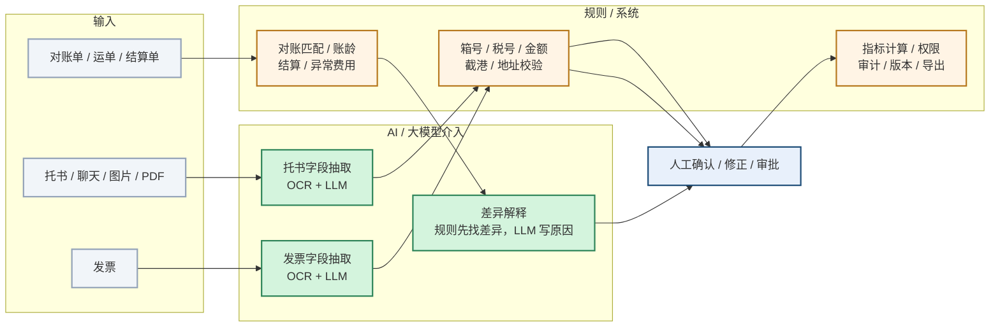

# AI 介入点全景

> 目的：把“哪里用了大模型、哪里只是规则、哪里必须人确认”画清楚，避免把系统功能包装成 AI。

## 1. 一张图看清

## 2. 逐环节说明

| 环节 | 谁主导 | 具体做什么 | 客户看到什么 |
|---|---|---|---|
| 托书结构化 | AI 读 + 规则 + 人 | OCR/LLM 抽字段；规则校验箱号/截港/地址；低置信转人工 | 结构化草稿 + 置信度 + 异常提示 |
| 发票识别 | AI 读 + 规则 + 人 | OCR/LLM 抽税号/金额/抬头；规则做勾稽；异常票转人工 | 发票草稿 + 风险标记 |
| 对账差异解释 | 规则匹配 + AI 解释 + 人 | 规则先匹配对账单/运单/结算单；LLM 只解释差异原因；人确认 | 差异分类 + 原因 + 待确认清单 |
| 账龄 / 结算 / 异常费用 | 规则 | 账龄分层、合同价核对、重复/算术/未知费用识别 | 清单 + 明细 + 导出 |
| 经营洞察 | 规则 | 指标目标 vs 快照、价值记录、续费风险，生成结论与建议 | 结论 + 指标差距 + 建议动作 |
| 内部交付平台草稿 | AI 草稿 + 人 | 方案/报告/摘要/问答草稿；未配置模型时回退规则 | 不进入客户生产，仅内部提效 |

## 3. 边界

- **AI 只负责“读”和“解释”**：托书、发票字段抽取；对账差异原因解释；内部草稿。
- **规则负责“查”和“算”**：箱号校验位、税号/金额勾稽、截港、地址、账龄、结算、异常费用、经营指标。
- **人负责“确认”**：AI 产出是草稿，确认后才进入业务；可撤销、可追溯。
- **系统负责“管”**：权限、审计、版本、导出、回滚。
- 对账匹配、账龄计算、结算规则、经营指标计算**不是大模型**，不包装成 AI。
