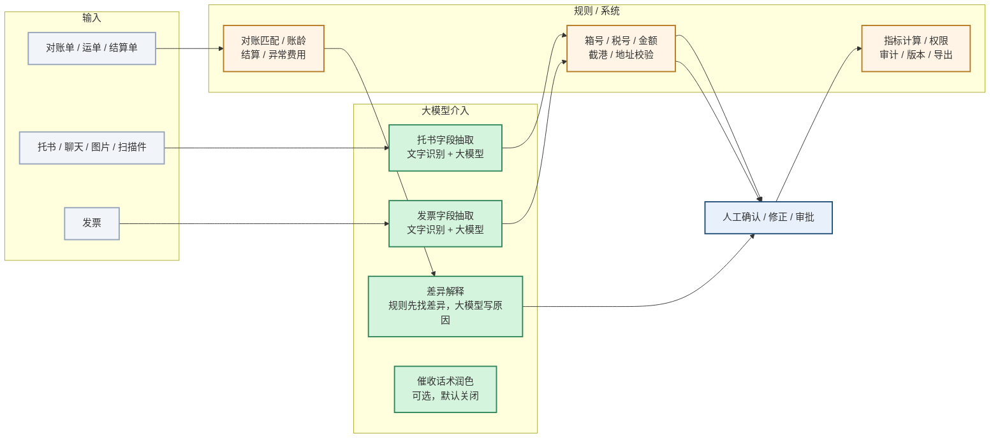

# 大模型介入点全景

> 目的：把“哪里用了大模型、哪里只是规则、哪里必须人确认”画清楚，避免把系统功能包装成人工智能。

## 1. 一张图看清

## 2. 逐环节说明

| 环节 | 谁主导 | 具体做什么 | 客户看到什么 |
|---|---|---|---|
| 托书结构化 | 大模型读 + 规则 + 人 | 文字识别/大模型抽字段；规则校验箱号/截港/地址；低置信转人工 | 结构化草稿 + 置信度 + 异常提示 |
| 发票识别 | 大模型读 + 规则 + 人 | 文字识别/大模型抽税号/金额/抬头；规则做勾稽；异常票转人工 | 发票草稿 + 风险标记 |
| 对账差异解释 | 规则匹配 + 大模型解释 + 人 | 规则先匹配对账单/运单/结算单；大模型只解释差异原因；人确认 | 差异分类 + 原因 + 待确认清单 |
| 报价解释 | 规则算价 + 可选模型解释 + 人 | 成本/市场中位/目标毛利由规则算；模型只写 2–3 句说明，数字越界回退 | 建议价 + 成本底线 + 风险 |
| 企业知识库问答 | 检索 + 可选模型 + 人 | 先检索 SOP/合同/报关口径，模型只根据命中的资料回答；必须引用原文 | 回答 + 引用；无依据说没有 |
| 在途事件抽取 | 规则先抽 + 可选模型补充 + 人 | 从调度/司机聊天抽提箱/装柜/进港/压车/改单等事件；证据必须可回查 | 事件卡片 + 风险提示 |
| 催收话术润色 | 规则定稿 + 可选模型 + 人 | 模板与数字由规则注入；模型只改措辞；不合规/不可用回退模板 | 默认关闭；人工核对后复制 |
| 账龄 / 结算 / 异常费用 | 规则 | 账龄分层、合同价核对、重复/算术/未知费用识别 | 清单 + 明细 + 导出 |
| 成本 / 单车毛利（客户侧） | 规则 | 单号优先 → 车辆+日期 → 待分摊；订单/车辆毛利 | 订单毛利 + 车辆汇总 + 待分摊 |
| 经营洞察（客户侧） | 规则 | 毛利/待分摊/逾期/风险订单汇总成结论与动作 | 结论 + 动作；不是大模型 |
| 经营洞察（诊断平台 S5） | 规则 | 指标目标 vs 快照、价值记录、续约风险 | 内部诊断报告；客户不登录 |
| 经营洞察 | 规则 | 指标目标 vs 快照、价值记录、续费风险，生成结论与建议 | 结论 + 指标差距 + 建议动作 |
| 内部交付平台草稿 | 大模型草稿 + 人 | 方案/报告/摘要/问答草稿；未配置模型时回退规则 | 不进入客户生产，仅内部提效 |

## 3. 边界

- **大模型只负责“读”和“解释”**：托书、发票字段抽取；对账差异原因解释；催收话术润色（可选）；内部草稿。
- **规则负责“查”和“算”**：箱号校验位、税号/金额勾稽、截港、地址、账龄、结算、异常费用、经营指标。
- **人负责“确认”**：大模型产出是草稿，确认后才进入业务；可撤销、可追溯。
- **系统负责“管”**：权限、审计、版本、导出、回滚。
- 对账匹配、账龄计算、结算规则、成本归集、单车毛利、经营指标计算**不是大模型**，不包装成人工智能。
