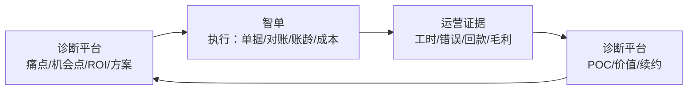

# 25 · 诊断平台与智单：功能与诊断内容对照

> 用途：把“诊断平台”和“智单”各自做什么、哪些重叠、哪些该互相喂数据，一次说清。
> 结论先行：**诊断平台管“为什么做、做什么、值不值得”；智单管“具体怎么做、做得怎么样”。**
> 口径：基于当前代码与文档，不基于宣传语。

---

## 一、结论

| 系统 | 定位 | 主要用户 | 核心产出 |
|---|---|---|---|
| **诊断平台**（`backend/` + `frontend/`） | 供应商内部诊断/方案/交付/价值 SaaS | 顾问、PM、实施、平台运营 | 诊断报告、机会点、方案/报价、POC 结论、交付计划、价值/续约 |
| **智单**（`ai-copilot/`） | 客户侧单租户业务系统 | 客户单证、财务、操作、管理层 | 结构化单据、对账差异、账龄、成本/毛利、在途、知识库、报价、预测 |

**两者不是互相替代，而是上下游：**
诊断平台决定“做哪个 AI/自动化点、值多少钱”；智单在执行层产生“单据、工时、错误、回款、成本”证据，反过来支撑诊断/价值。

---

## 二、功能对照

### 2.1 诊断平台实际功能

| 模块 | 代码/页面 | 实际内容 |
|---|---|---|
| **S1 诊断** | `s1.ts`、`EngagementPage` 的 Pains/Inventory/People/Process/Opportunities/Risks/Reports | 客户/项目、干系人、访谈、痛点（来源必填、量化影响）、四维盘点（业务/数据/系统/组织）、流程节点、机会点评分（价值×可行性×紧迫度）、基线、ROI、风险、确认、G1 门禁、诊断报告 |
| **S2 方案** | `s2.ts`、`s2_docs.ts`、Solutions/Quotes | 方案版本、组件、集成、工作量、验收标准、评审、报价、报价版本对比、G2 十二项校验、Word/PDF |
| **S3 POC** | `s3.ts`、`s3_docs.ts`、PocTab | 实验、样本/数据集、运行记录、复核、结论、Go/No-Go、G3 门禁、POC 报告 |
| **S4 交付** | `s4.ts`、`s4_docs.ts`、DeliveryTab | 实施计划、任务/里程碑、UAT、上线检查、培训、问题/变更、G4 门禁、交付文档 |
| **S5 运营/价值** | `s5.ts`、`s5_docs.ts`、ValueTab、InsightsTab | 指标定义、目标、快照、价值记录、使用记录、续约风险、G5 九项校验、价值报告、项目经营洞察 |
| **R6 知识/AI 草稿** | `r6.ts`、KnowledgePage、AiTab | 知识条目（行业/机会/模式/模板/案例）、相似项目、访谈摘要/报告/方案/PRD/问答草稿、人工确认 |
| **平台运营** | `platform.ts`、`billing.ts`、`auth.ts` | 多租户、RLS、试用/套餐/配额、账单/模拟支付、平台管理员、租户导出/删除 |
| **协作/审计** | `collab_audits.ts`、`notifications.ts`、`AuditPage` | 协作审计、通知、分享、导出任务、归档 |

### 2.2 智单实际功能

| 模块 | 页面/API | 实际内容 |
|---|---|---|
| 文档 AI | `/`、`/invoice`、`/batch`、`/api/extract*` | 托书/发票 OCR + 大模型字段抽取、规则校验、分级审批、批量 |
| 对账/结算 | `/reconcile`、`/pilot`、`/threeway`、`/settlement`、`/fees` | 对账单↔运单、三单匹配、外协结算、异常费用、差异复核 |
| 应收/账龄 | `/aging` | 账龄分档、客户风险、催收清单/话术 |
| 成本/毛利 | `/margin` | 单号/车辆成本归集、订单/车辆毛利、待分摊 |
| 经营洞察 | `/insight`、`/profit` | 毛利/待分摊/逾期/风险订单 + 可选 AI 简报/优先级/动作草稿、客户/线路盈利 |
| 能源/线路决策 | `/fleet` | 油/电、大/小马力、空驶、人力工时对比；公开资料 + 合成数据，未计 TCO |
| 经营驾驶舱 | `/dashboard` | 老板视图聚合经营结果/客户线路/能源线路；演示样张，三模块不可加总 |
| 在途/查询 | `/events`、`/track` | 聊天事件抽取、箱号/单号/客户查询、ETA/报关/时间线 |
| 知识库 | `/kb` | 客户 SOP/合同/报关口径检索 + 引用问答 |
| 报价 | `/quote` | 历史价/成本/目标毛利 → 建议报价/风险 |
| 单证一致性 | `/consistency` | 托书/发票/对账单交叉核对 |
| 关务 | `/customs` | 客户 HS 词库候选、模型候选内选择 |
| 调度/预测 | `/dispatch`、`/forecast` | 调度/装箱优化（500 单/60 车合成回归）、客户信用/回款/线路趋势 |
| 配置/审计 | `/settings`、`/history`、`/learn`、`/report` | 41 项运行级配置、确认历史/撤销、学习队列、月报 |

---

## 三、诊断内容对照

### 3.1 诊断平台诊断什么

| 诊断对象 | 具体内容 | 数据来源 |
|---|---|---|
| 痛点 | 客户原话、渠道、频率、严重度、量化影响、现有绕行、来源类型/来源引用 | 访谈/观察/数据；来源不能为空 |
| 四维盘点 | 业务/数据/系统/组织，完整度、是否已验证、隐性项 | 访谈/观察/数据 |
| 机会点 | 价值分、可行性分、紧迫度、数据就绪、技术阻断、阶段、优先级 | 诊断结论 |
| 基线 | 指标、数值、单位、来源、采集时间、置信度 | 客户数据 |
| ROI | 收益类型、公式、保守/中性/乐观、一次性/年运维、实现形态/系数 | 基线 + 假设 |
| 风险/确认 | 风险类型、概率/影响、确认人/方式/证据 | 项目过程 |
| 门禁 | G1–G5：诊断、方案、POC、交付、价值 | 项目数据 |

**诊断内容的核心是“判断”：这个痛点值不值得做、能不能做、做完值多少钱。**

### 3.2 智单产出什么

| 产出 | 具体内容 | 用途 |
|---|---|---|
| 结构化单据 | 托书/发票/对账单/结算单字段 + 置信度 + 异常 | 执行层数据 |
| 对账差异 | 一致/金额不符/系统无此单/客户漏单 + 证据/决策 | 财务执行 |
| 账龄 | 分档、逾期、客户风险、催收话术 | 应收执行 |
| 成本/毛利 | 单号/车辆归集、待分摊、订单/车辆毛利 | 经营执行 |
| 在途 | 状态、ETA、报关、时间线、事件 | 客服/操作 |
| 知识 | 客户 SOP/合同/报关口径 + 引用 | 执行知识 |
| 报价/关务/预测 | 建议价、HS 候选、回款/信用/线路趋势 | 经营辅助 |

**智单产出的是“证据”：真实单据、真实差异、真实工时、真实回款。**

### 3.3 两者的关系

- 诊断平台给“方向”；
- 智单给“证据”；
- 证据回到平台，支撑 POC 结论和价值核算。

---

## 四、重叠与边界

| 能力 | 诊断平台 | 智单 | 判断 |
|---|---|---|---|
| 知识库 | 内部方法论/行业案例/模板（`knowledge_items`，按 org） | 客户 SOP/合同/报关口径（`/kb`，单租户） | **不合并**：一个是顾问知识，一个是客户知识 |
| 经营洞察 | S5 项目价值/续约风险（`insights.ts`，规则） | 客户毛利/逾期/风险订单（`/insight`、`/profit`） | **不同对象**：项目价值 vs 客户经营 |
| 对账 | 存复核记录/报告/风险待办（`pilot_reviews`、`reconcile_docs`） | 实际匹配/差异/复核（`/reconcile`、`/pilot`） | 平台消费智单结果，不重复做匹配 |
| 报告 | 诊断/方案/POC/交付/价值 Word/PDF | 运行月报 `/report` | 不同读者/周期 |
| AI 草稿 | 访谈摘要/报告/方案/PRD/问答（R6） | 报价解释/催收话术/知识库回答 | 不同任务；平台不写客户业务话术 |
| 指标 | S5 项目指标/目标/快照 | 运营指标/月报/毛利/预测 | 平台指标是项目价值，智单指标是业务运行 |
| 审计 | 协作审计/操作审计 | 解析/确认/撤销/修订流水 | 不同范围，可互相引用 |
| POC | 实验/运行/复核/结论 | 评测 `eval` / 交付钩子 | 平台存结论，智单算指标 |
| 多租户 | 供应商多租户 SaaS | 客户单租户 | 不混为一个应用 |

### 命名冲突（必须在材料里改）

| 词 | 平台含义 | 智单含义 | 建议 |
|---|---|---|---|
| 经营洞察 | S5 项目价值/续约风险 | 客户毛利/逾期/风险订单 | 平台叫“项目价值洞察/续约风险”，智单叫“客户经营洞察” |
| 知识库 | 顾问方法论/案例 | 客户 SOP/合同/报关口径 | 平台叫“方法论知识库”，智单叫“客户知识库” |
| 对账复核 | pilot one 复核记录/报告 | 实际对账差异复核 | 平台叫“对账复核记录”，智单叫“自动对账/复核” |
| 报告 | 诊断/方案/价值报告 | 运行月报 | 材料里写清读者 |

---

## 五、当前数据流与缺口

### 已打通

- 智单评测结果 → 平台 POC 运行记录：`/api/hooks/copilot/eval`（幂等 + token）。
- 智单对账复核 → 平台 pilot 复核：`/api/hooks/copilot/reconcile`。
- 平台只收聚合结果/复核，不收原始单据；符合“客户数据不出客户边界”。

### 缺口

| 缺口 | 影响 | 建议 |
|---|---|---|
| S5 价值记录没有自动吃智单月报 | 价值核算仍靠手工抄 | 增加“月报指标 → S5 价值记录”的聚合钩子（只传聚合，不传原文） |
| S1 诊断没有引用智单运营证据 | 诊断基线可能靠访谈 | 允许导入“工时/准确率/绕过率/回款”聚合指标作为证据 |
| 平台知识库与智单知识库完全隔离 | 顾问看不到客户 SOP；客户看不到方法论 | 保持隔离；需要时由人摘要后入平台，不自动同步 |
| 平台“经营洞察”与智单“经营洞察”同名 | 会客材料容易混 | 材料改名；PPT 不再用 S5 截图讲客户经营 |

---

## 六、建议

1. **平台只做诊断/方案/交付/价值，不重做 OCR、对账、账龄、成本。**
2. **智单只做客户执行，不承载项目诊断、报价审批、交付管理。**
3. **平台消费智单聚合结果**：POC 指标、对账复核、月报节省工时/绕过率；不拉原始单据。
4. **知识库分开**：平台方法论库 vs 客户知识库；不自动互灌。
5. **材料改名**：平台“项目价值洞察/续约风险”；智单“客户经营洞察/盈利分析”。
6. **对协丰**：先用平台 S1 做诊断/机会点，再用智单 P0（单证/对账/应收）产生证据，回到 S3/S5；不要用智单演示页替代诊断报告。

---

## 七、复核依据

| 系统 | 代码/页面 |
|---|---|
| 诊断平台 | `backend/src/routes/s1–s5.ts`、`r6.ts`、`insights.ts`、`copilot.ts`、`frontend/src/pages/tabs/*` |
| 智单 | `ai-copilot/app/*`、`ai-copilot/static/*`、`ai-copilot/docs/AI需求实施计划.md` |
| 平台验证 | `verify:write` 51/51、e2e 25/25、前端单测 13 |
| 智单验证 | `smoke.sh` 16/16、AI-01–AI-50 节点证据 |
