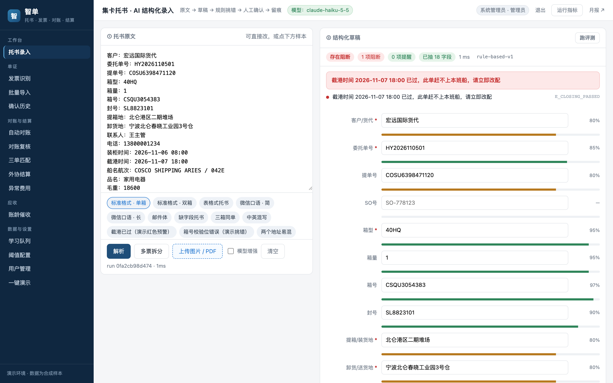
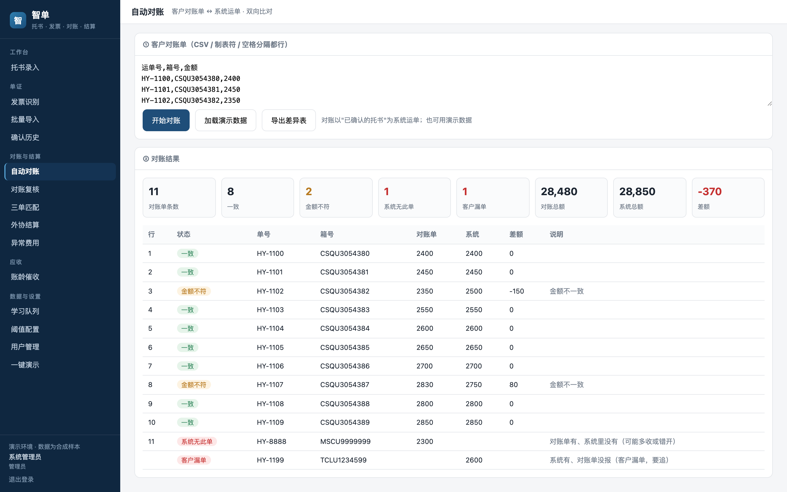
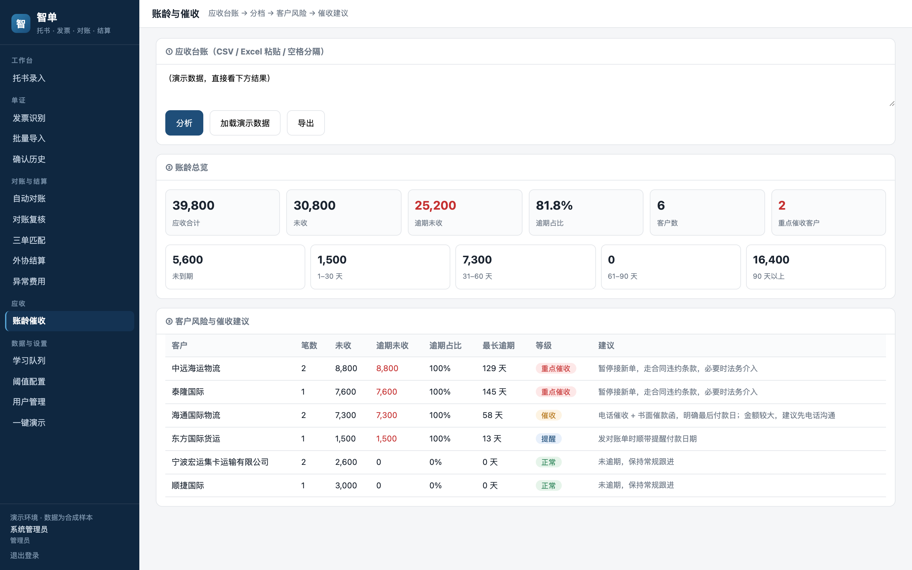

# 智单 · 托书结构化试用指南

> 目标：用最小成本验证“客户发来的托书，能不能稳定变成可用字段”。
> 边界：这是试点验证，不是直接上线；真实客户数据必须先脱敏并获得授权。
> 系统名：客户看到的是「**智单**」（登录页与左侧菜单）；部署目录、服务名仍是 `ai-copilot`，不影响使用。

---

## 零、界面怎么走（先看这一节）

登录后，功能都在**左侧菜单**；顶栏是当前页标题和操作，往下滚动时不动。



| 分组 | 菜单 | 做什么 | 谁能看到 |
|---|---|---|---|
| 工作台 | 托书录入 | 粘贴 / 上传 / 样例 → 结构化草稿 → 确认 | 全部角色 |
| 单证 | 发票识别 | 发票字段抽取与勾稽校验 | 全部角色 |
| 单证 | 批量导入 | 一次几十份图片 / PDF | 全部角色 |
| 单证 | 单证一致性 | 托书/发票/对账单交叉核对 | 管理员 / 单证员 / 财务 |
| 单证 | 关务助手 | 商品描述 → HS 候选（客户词库；示例需报关行确认） | 管理员 / 单证员 / 财务 |
| 单证 | 确认历史 | 查已确认单据、撤销（撤销仅管理员） | 管理员 |
| 对账与结算 | 自动对账 | 客户对账单 ↔ 系统运单，找差异 | 全部角色 |
| 对账与结算 | 对账复核 | 逐条差异选「采纳 / 修改后采纳 / 忽略」+ 备注 | 全部角色 |
| 对账与结算 | 三单匹配 | 订单 ↔ 运单 ↔ 发票 | 全部角色 |
| 对账与结算 | 外协结算 | 合同价 × 数量 ↔ 车队报账 | 全部角色 |
| 对账与结算 | 异常费用 | 重复收费、算术不符、未知费用、同批离群 | 管理员 / 财务 |
| 应收 | 账龄催收 | 应收台账 → 分档 → 客户风险 → 催收建议；可选 AI 润色（默认关闭） | 全部角色 |
| 执行 | 客户查询 | 箱号/单号/客户 → 状态、ETA、报关、时间线（合成演示） | 管理员 / 操作 / 财务 |
| 执行 | 调度优化 | 订单/车辆/装箱优化前后对比（合成演示） | 管理员 / 操作 |
| 经营 | 预测信用 | 客户风险、回款、线路趋势（合成演示） | 管理员 / 财务 |
| 经营 | 盈利分析 | 客户/线路收入、成本、毛利、集中度（合成演示） | 管理员 / 财务 |
| 执行 | 在途异常 | 调度/司机聊天 → 事件卡片（提箱/装柜/压车/改单/异常） | 管理员 / 单证员 |
| 经营 | 报价助手 | 询价 → 历史价/成本 → 建议报价 + 风险；通用演示 | 管理员 / 操作 / 财务 |
| 成本 | 单车毛利 | 应收 + 费用 → 单票/单车毛利；通用演示 | 管理员 / 财务 |
| 成本 | 经营洞察 | 毛利/待分摊/逾期/风险订单 → 结论与动作 | 管理员 / 财务 |
| 数据与设置 | 学习队列 | 人改过的难例，标注成金标 | 管理员 / 单证员 / 财务 |
| 数据与设置 | 知识库 | SOP/合同/报关口径检索 + 引用原文问答 | 全部角色 |
| 数据与设置 | 阈值配置 | 39 项运行级配置（阈值/开关/模板），改完立即生效 | 管理员 |
| 数据与设置 | 用户管理 | 四角色账号 | 管理员 |
| 数据与设置 | 一键演示 | 13 步全链路，会客时按顺序讲 | 全部角色 |

> - 手机打开时菜单收成抽屉，点左上角按钮展开。
> - 客户**不登录**供应商的诊断平台；诊断平台是实施团队在现场用的内部工具，客户侧只用这套系统。

---

## 一、先选一种试法

| 试法 | 时间 | 适合谁 | 能看到什么 |
|---|---|---|---|
| 看内置样例 | 5 分钟 | 老板 / 业务负责人 | 界面、字段、置信度、规则挑错 |
| 贴 1–3 份真实托书 | 30 分钟 | 单证主管 / 一线骨干 | 真实格式能不能抽、错在哪里 |
| 20–50 份小评测 | 半天–1 天 | 业务负责人 + 一线 | 字段准确率、整单正确率、人工修正耗时 |

建议顺序：**先看样例 → 再贴 3 份真实托书 → 再决定要不要做 20–50 份评测。**

---

## 一之一、不一定非要复制粘贴：五种入口

| 入口 | 现在能不能用 | 适合什么 | 需要什么 |
|---|---|---|---|
| 网页粘贴 | 能 | 临时试 1–3 份 | 打开网页 |
| H5 拍照/上传 | 能 | 单证员在手机上拍托书 | `http://127.0.0.1:8790/h5` |
| 批量导入 | 能 | 一次几十份图片/PDF | `http://127.0.0.1:8790/batch` |
| 企业微信文字消息 | 能 | 客户/单证在企微里直接发文字 | 企微自建应用、回调地址、Token/AES Key |
| 企业微信图片消息 | 能（需配置 Secret/AgentID） | 客户爱发截图/照片 | 异步 OCR，识别完主动推送结果 |
| 邮件转发 | 暂未接入 | 客户习惯邮件发托书 | 需加 IMAP/邮件解析 |
| TMS 导出 CSV | 能 | 已有结构化台账 | `POST /api/import/tms` |

> 结论：文字可以做到“发企微就自动进系统”；图片也已接入（先回执，识别完主动推送）。演示前要先配好 `WECOM_SECRET` / `WECOM_AGENTID`；真实企微联调尚未完成，演示以文字为主。

> 左侧菜单能直接进：托书录入、发票识别、批量导入、自动对账、对账复核、三单匹配、外协结算、异常费用、账龄催收、单车毛利、经营洞察；H5 是单独的移动端页面，不在菜单里。

## 一之二、托书不是一条发完怎么办

微信群里的托书经常是分几条发的。系统支持“分条录入”：

1. 先发：`分条`
2. 逐条发内容，例如：
   - `客户：宏远国际货代`
   - `委托单号：HY2026110501`
   - `箱型：40HQ，箱量：1`
   - `箱号：CSQU3054383，截港：2026-11-07 18:00`
   - `提箱地：北仑港区二期堆场，卸货地：宁波北仑春晓工业园3号仓`
3. 发完回复：`完成`
4. 系统把多条合并成一张托书，返回结构化字段。
5. 确认入库回复：`确认`；不想发了回复：`取消`。

也可以直接发一条不完整的信息，系统会先记成草稿，并提示继续发；发完回复「完成」即可。

> 草稿按企业微信用户隔离，30 分钟内有效。系统不会把半条消息直接入库。

## 一之三、H5 拍照/上传怎么试

### 先在电脑上试（2 分钟）

1. 手机或电脑打开 `http://127.0.0.1:8790/h5`（移动端页面，不在左侧菜单里）。
2. 用管理员分配的账号登录；如果先跳到登录页，登录后再打开一次 `/h5`。
3. 点「拍照 / 上传」，选一张托书图片或 PDF（单文件 ≤10MB）。
4. 看识别结果：字段、逐字段置信度、规则提示。
5. 改错后点「确认入库」。

### 用手机拍照试（同一 Wi-Fi）

当前本机服务只监听 `127.0.0.1`，手机访问不到。临时开一个局域网端口：

```bash
cd ai-copilot
.venv/bin/python -m uvicorn app.main:app --port 8792 --host 0.0.0.0
```

先查这台 Mac 的局域网 IP：

```bash
ipconfig getifaddr en0
```

手机打开 `http://<Mac 局域网 IP>:8792/h5`，登录后点「拍照 / 上传」，选「拍照」。
> 只用于内网试用；正式使用要固定域名 + HTTPS，不要把 8792 暴露到公网。

或者用临时 HTTPS 隧道（URL 每次重启会变）：

```bash
cloudflared tunnel --url http://127.0.0.1:8790
```

手机打开输出里的 `https://...trycloudflare.com/h5`。

### 边界

- 支持图片、PDF，也支持 txt/csv 文本文件；单文件 ≤10MB。
- 「拍照」调用手机系统相机/相册，不是网页内实时预览。
- 图片太糊会识别失败，换清晰照片或改用粘贴文字。
- 企微图片消息已接：发图后先回执，识别完主动推送；PDF、多张图仍建议走 H5 或批量导入。

## 一之四、网站粘贴怎么试

适合临时试 1–3 份，不用装任何东西。

1. 左侧菜单点「托书录入」（或打开 `http://127.0.0.1:8790/`）。
2. 用管理员账号登录。
3. 把托书原文粘贴到页面左栏「托书原文」——微信消息、邮件正文、Excel 复制出来的文字都行。最左边是菜单，不是输入框。
4. 点「解析」。
5. 右侧会显示：抽出的字段、逐字段置信度、规则提示、审核级别。
6. 手工改错后点「确认并记录」。

要点：

- 点内置样例只用于演示，**不计入来单统计**；真实粘贴才算。
- 同一段文字重复点「解析」不会重复计数；改了内容再解析会算新的一次来单。
- 「模型增强」默认打开；不配模型时会自动回退规则引擎，页面会标明当前引擎，不会把规则结果说成大模型结果。
- 也可以点「上传图片 / PDF」走 OCR；上传入口单独计数，不会和粘贴重复。

## 一之五、批量导入怎么试

适合一次几十份图片/PDF。批量页默认**只用规则、不做模型调用**，并默认脱敏。

1. 左侧菜单「批量导入」（或打开 `http://127.0.0.1:8790/batch`）。
2. 输入批次名（例如“宏运-2026-11-档案室抽样”），类型选「托书」，点「新建批次」。
3. 选中刚建的批次，点「选择文件」，一次可多选图片/PDF/txt/csv。
4. 点「开始处理」。
5. 看进度：总数、已识别、待处理、失败、完成度，以及每个文件的状态和单号。
6. 失败的行可以点「重试」；处理到一半服务重启，再点一次「开始处理」会继续剩下的。

边界：

- 单次最多 200 个文件，单文件 ≤10MB。
- 批量页只显示状态和单号，不展开字段；要看某一份的字段，用单号查：
  `GET /api/audit/<run_id>`
- 默认 `use_llm=false&mask=true`：只走规则、存库前脱敏。适合试点先看“能不能抽出来”，不要拿它当真实准确率。
- 每份文件都会写一条 `batch-booking` 来单记录，并关联到对应单号，方便统计“绕过率”。

## 一之六、自动对账怎么试（3 步）



1. 左侧菜单点「自动对账」。
2. 把客户发来的对账单贴进输入框（CSV / 制表符 / 空格分隔都行），或点「加载演示数据」。
3. 点「开始对账」，看四类结果：一致 / 金额不符 / 系统无此单 / 客户漏单。

看到差异之后：

- 进「对账复核」，逐条选「采纳 / 修改后采纳 / 忽略」，填写原因或处理备注，保存；
- 需要给财务跟进时，在「自动对账」页点「导出差异表」。

口径边界：

- 匹配、金额容差、四类差异都是**规则**，不是大模型；
- 只有打开差异解释时，模型才写「可能原因 / 建议动作」，金额和差异类型不改；
- 系统给的是**建议动作**，最终处理决定由人做；没有自动派单，也没有逐条负责人字段。

## 一之七、账龄催收怎么试（3 步）



1. 左侧菜单点「账龄催收」。
2. 贴应收台账（列：客户、单号、应收、已收、到期日），或点「加载演示数据」。
3. 点「分析」，看未收 / 逾期未收 / 逾期占比、账龄分档、客户等级与催收建议。

口径边界：

- 分档、逾期天数、占比、等级和催收建议都是**规则统计**，不是预测模型；
- 建议是通用动作（提醒 / 电话催收 / 暂停接单走法务），要不要执行由业务判断；
- 可选的「AI 润色」默认关闭，模型只改措辞，金额/天数由规则锁定，人工核对后才复制。

## 二、5 分钟看样例

1. 打开 `http://127.0.0.1:8790/`。
2. 用管理员分配的账号登录。
3. 点「托书原文」下方的样例按钮，例如「标准格式 · 单箱」；样例只用于演示，不计入来单统计。
4. 点「解析」。
5. 看右侧「结构化草稿」：
   - 每个字段是否抽对；
   - 每个字段的置信度；
   - 规则有没有主动挑错；
   - 是否需要人工修改。

> 当前演示环境已经打开并跑过「标准格式 · 单箱」，可以直接看结果。

---

## 三、30 分钟贴真实托书

### 准备

- 1–3 份**已脱敏**的真实托书：微信文字、邮件、图片或扫描件都可以。
- 至少包含：客户、委托单号、箱型、箱量、箱号、提箱地、卸货地、截港时间、品名、重量。
- 最好再准备 1 份“格式很乱”的托书，用来看最差情况。

### 操作

1. 把托书原文粘贴到页面左栏「托书原文」。
2. 如果是图片/PDF，点「上传图片 / PDF」。
3. 点「解析」。
4. 逐字段检查：
   - 必填字段有没有空；
   - 箱号/封号/时间/地址有没有抽错；
   - 规则有没有提示“箱号校验位错误 / 截港已过 / 地址冲突”。
5. 手工改错，点「确认并记录」。
6. 记录：**改了几个字段、花了多少秒、最常错的是哪几个字段。**

### 重点看什么

- 不是看“模型多聪明”，而是看**单证员要改多少**。
- 规则能挑出的错，比模型多抽一个字段更有价值。
- 如果一份托书要改 8 个字段，说明格式还没覆盖，需要补规则或补样本。

---

## 四、半天–1 天小评测

### 样本

- 20–50 份真实托书，覆盖主要客户和主要格式。
- 按客户/格式分组，避免只拿最标准的几份。
- 脱敏后再给，敏感字段可用假名/假号替换。

### 记录表

| 托书编号 | 格式 | 字段总数 | 抽对字段 | 人工修改字段 | 修正耗时（秒） | 规则告警 | 整单是否全对 |
|---|---|---|---|---|---|---|---|
| S01 | 标准单箱 |  |  |  |  |  |  |
| S02 | 微信口语 |  |  |  |  |  |  |

### 指标

- **字段准确率** = 抽对字段 / 总字段
- **整单正确率** = 一次不用改的单 / 总单
- **平均修正耗时** = 每单人工修改时间
- **规则拦截率** = 规则主动发现的错误 / 总错误

> 真实准确率必须用客户样本跑出来；内置样例和合成样本的数字不能对外当结论。

---

## 四之一、20–50 份小评测工具

模板和脚本已经准备好：

- 模板：`会客包/试点一/托书评测模板/`
- 脚本：`ai-copilot/scripts/eval_booking_folder.py`

把脱敏托书按 `S01.txt`、`S02.txt` 放好，填 `gold.csv`，运行：

```bash
cd ai-copilot
PYTHONPATH=. .venv/bin/python scripts/eval_booking_folder.py \
  --dir ../会客包/试点一/托书评测模板/docs \
  --gold ../会客包/试点一/托书评测模板/gold.csv \
  --out data/booking_eval.csv \
  --report data/booking_eval.md
```

输出：字段准确率、整单全对率、平均耗时、阻断单、错在哪个字段。脚本只做评测，不写入正式解析记录。

## 五、需要客户配合什么

| 角色 | 配合内容 | 投入 |
|---|---|---|
| 业务负责人 | 定验收口径、挑样本、看结果 | 每周 30 分钟 |
| 单证主管 / 一线骨干 | 解释托书格式、判断抽得对不对 | 首周 2 小时 + 试用 |
| 信息化接口人 | 环境、账号、图片/PDF 上传权限 | 首周 2–3 小时 |
| 数据 / 安全 | 脱敏规则、数据边界确认 | 1 次评审 |

---

## 六、数据与安全

- 真实托书必须先脱敏，去掉客户全名、电话、地址中的敏感信息（或替换为假数据）。
- 默认客户内网/客户云部署；外部模型调用需单独确认合规。
- 不配置模型时，系统回退规则抽取；页面会标明当前引擎，不把规则结果包装成大模型结果。
- AI 产出是草稿，人工确认后才进入业务，修改全部留痕。

---

## 七、试完怎么判断

**可以继续：**

- 3 份真实托书里，至少 2 份主要字段基本正确；
- 规则能发现箱号、截港、地址等关键错误；
- 单证员认为“比手抄快”或“至少不用来回翻微信”。

**先别扩大：**

- 同一份托书要改一半以上字段；
- 关键字段（箱号、截港、客户）经常错；
- 样本格式差异太大，规则覆盖不了；
- 客户不愿意提供脱敏样本或没有验收人。

---

## 八、下一步

如果 3 份真实托书能跑通，建议进入 20–50 份小评测；评测通过后再谈 3 周试点和正式部署。

需要准备的三样东西：

1. 20–50 份脱敏托书；
2. 1 名内部负责人；
3. 1 套验收口径（字段准确率、整单正确率、修正耗时）。

---

## 九、企业微信能不能直接绑定、自动从对话里提取

要区分三种情况：

| 方式 | 能不能自动 | 说明 | 需要什么 |
|---|---|---|---|
| 把托书发给企业微信自建应用 | **能（文字）** | 系统通过回调接收消息，自动解析并回复 | 自建应用、回调地址、Token、AES Key、CorpID |
| 把截图/图片发给企业微信自建应用 | **能（需配置）** | 下载临时素材后异步 OCR，识别完主动推送结果 | 应用 Secret、AgentID、可信 IP、固定域名 |
| 自动读取员工与客户的已有聊天记录 | **可以，但走会话内容存档** | 不是普通自建应用能力，需要企业开通会话存档、员工/客户授权、RSA 密钥与 SDK | 企业管理员、会话存档许可、合规确认 |
| 读取个人微信聊天 | **不行/不建议** | 没有官方接口，抓取有封号与合规风险 | 不做 |

### 推荐做法

先做“**把托书转发给企业微信应用**”，不要一开始读全部聊天：

1. 企业微信管理后台创建自建应用。
2. 配置接收消息回调：`https://你的域名/api/wecom/callback`。
3. 服务端配置 `WECOM_TOKEN`、`WECOM_ENCODING_AES_KEY`、`WECOM_CORPID`。
4. 员工/单证把托书文字发给应用，系统自动解析并回复。
5. 配置 `WECOM_SECRET` / `WECOM_AGENTID` 后，图片可直接发给应用；未配置时系统会提示走 H5。

> 这样合规风险最低、上线最快，也足够验证“托书结构化”是否有价值。  
> “自动读全部聊天”属于会话内容存档，需要单独评估合规和许可，不适合作为第一步。
