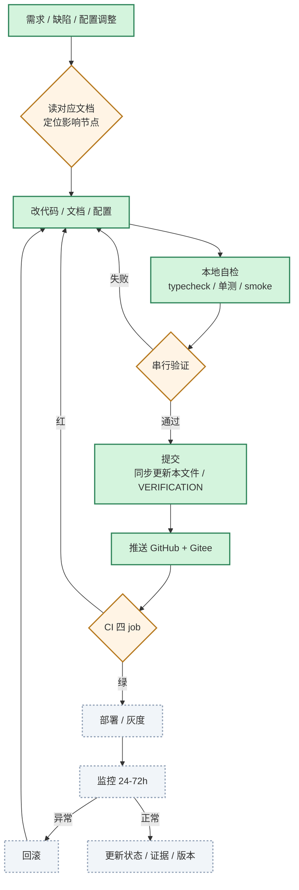
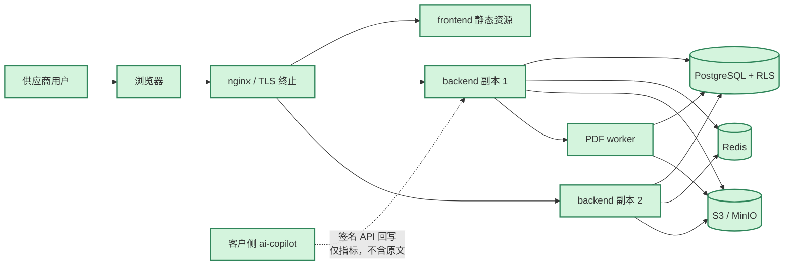

# Enterprise AI 内部开发与发布

> **版本**：v1.1 ｜ **更新**：2026-11-07 ｜ **基线**：`5c91604`
>
> **定位**：本文件只记录**供应商内部**的产品开发、CI、发布、架构与运行底座。
> **不包含**：客户现场实施阶段。现场实施看 `实施全景图.md`。
>
> **适用范围**：研发、测试、运维、发布负责人；**不作为客户交付材料，不发给客户**。
>
> **系统边界**：诊断平台（`backend/` + `frontend/`）是供应商内部 SaaS，不部署到客户；`ai-copilot` 是客户实际使用的系统。详见 `会客包/12_系统边界与落地清单.md`。

---

## 0. 与现场实施图的边界

| 文档 | 管什么 | 谁看 | 客户是否可见 |
|---|---|---|---|
| `实施全景图.md` | 客户现场实施：诊断、部署、样本、试运行、培训、验收、移交 | 交付团队 + 客户项目组 | 可裁剪后给客户 |
| `内部开发与发布.md` | 产品开发、CI、发布、架构、多租户/HA、运行底座 | 研发 / 测试 / 运维 | **不可见** |
| `AGENTS.md` | 协作铁律与验证顺序 | 所有 Agent / 开发者 | 内部 |

**硬规则**：现场实施变更更新 `实施全景图.md`；代码、CI、发布、架构变更更新本文件。两边都影响时，两边同提交更新。

---

## 1. 开发阶段与发布闭环

**执行顺序（禁止并行）**

1. 定位节点 → 2. 改代码 → 3. 自检 → 4. `verify` / `verify:write` → 5. e2e（单独跑） → 6. 更新文档与证据 → 7. commit → 8. push 双远端 → 9. CI 四 job 全绿 → 10. 部署/灰度 → 11. 监控 → 12. 回滚预案待命。

> `verify:write` 与 e2e 共用测试库/端口，**不能同时跑**；CI 的 e2e 失败会重试 1 次，本地复验不带重试，结果更严格。

---

## 2. 诊断平台与运行底座（供应商内部）

### 2.1 部署拓扑

> 诊断平台**不部署到客户**；客户侧只部署 `ai-copilot`。上图仅描述供应商自己的 SaaS。

### 2.2 多租户与运行底座

```mermaid
flowchart LR
  A[供应商自助注册] --> B[组织 + 首管理员]
  B --> C[org_slug 登录]
  C --> D[请求级 org 上下文]
  D --> E[PostgreSQL RLS]
  E --> F[客户 / 项目 / 报告 / 知识库隔离]

  B --> G[14 天试用]
  G --> H[套餐 / 配额]
  H --> I[账单 / 模拟支付 / HMAC 回调]
  I --> J[订阅到期 / 暂停]
  J --> K[平台管理员<br/>租户列表 / 暂停恢复 / 调整套餐]
  K --> L[租户导出 / 删除]

  subgraph INFRA[运行底座]
    N1[Redis 限流 + 会话缓存 ✅]
    N2[S3 / MinIO 对象存储 🟡]
    N3[PDF 队列 SKIP LOCKED ✅]
    N4[多副本 Compose + nginx ✅]
    N5[K8s 清单 / PDB / 迁移 Job 🟡]
    N6[备份 / 恢复 / PITR ✅]
    N7[SLO / 告警 / 值班 🟡]
    N8[滚动发布 / 回滚演练 ✅]
  end

  F --> INFRA
  INFRA --> M[供应商生产环境 ⬜]

  classDef done fill:#d4f4dd,stroke:#2f855a,stroke-width:2px
  classDef partial fill:#fff4e5,stroke:#b7791f,stroke-width:2px,stroke-dasharray:5 5
  classDef todo fill:#f1f5f9,stroke:#94a3b8,stroke-width:2px,stroke-dasharray:3 3
  class A,B,C,D,E,F,G,H,K,L,N1,N3,N4,N6,N8 done
  class I,J,N2,N5,N7 partial
  class M todo
```

**关键边界**

- 诊断平台是**供应商多租户 SaaS**；ai-copilot 是**单租户客户交付系统**，两者不混为一个应用。
- 多租户隔离靠 PostgreSQL RLS + 受限角色 + 请求级 `app.org_id`，不是只靠代码 `where org_id`。
- 真实支付、发票、自动扣费、K8s 预发、Alertmanager 真实触发、真实 S3 都还没验证。

---

## 3. 开发检查表

> 状态说明：`[x]` 有证据；`[ ]` 未完成或外部未验证。每项右侧写证据或命令，禁止空勾。
> 本表是内部研发口径；客户现场是否可用，另见 `实施全景图.md` §10.11。

### 3.1 诊断平台 S1–S5

| ID | 检查项 | 状态 | 证据 / 验收 |
|---|---|---|---|
| S1-01 | 项目、客户、干系人、访谈记录 | [x] | 前端工作台 + 后端 API |
| S1-02 | 痛点、四维盘点、业务流程、机会点与 ROI、风险与局限 | [x] | S1 页面与 API |
| S1-03 | 报告、确认与签收、行业标杆、回收站、审计日志 | [x] | `confirmations` / 审计 API |
| S1-04 | CSV / Excel 批量导入（整批校验、失败回滚） | [x] | 导入接口 + 前端 |
| S1-05 | G1 诊断门禁（客户确认、标杆校准） | [x] | G1 校验规则 |
| S1-06 | 一个真实客户走完 G1 | [ ] | 需真实客户确认记录 |
| S2-01 | 8 张表：方案版本 / 组件 / 集成 / 工作量 / 验收 / 评审 / 报价 | [x] | 迁移 + API |
| S2-02 | 方案工作台、报价页、方案/报价 Word 导出 | [x] | 前端 + 导出 |
| S2-03 | 方案/报价版本对比、客户版脱敏导出 | [x] | 对比接口 + 脱敏 |
| S2-04 | G2 十二项校验（覆盖 / 报价 / 验收 / 阻断 / 负责人 / 人天） | [x] | G2 校验 |
| S2-05 | 6 份交付物：方案书 / 架构 / 集成清单 / PRD / 报价 / 验收标准 | [x] | 模板 + 导出 |
| S2-06 | 一个真实机会点走完 G2 | [ ] | 需真实客户与确认 |
| S3-01 | 5 张表：实验 / 样本 / 运行 / 复核 / 结论 | [x] | 迁移 + API |
| S3-02 | POC 页签、G3 八项校验、POC 报告 Word | [x] | 前端 + 校验 |
| S3-03 | Go / No-Go 联动机会点阶段 | [x] | `go → validated` / `no_go → parked` |
| S3-04 | 一个真实 POC 从设计到结论 | [ ] | 需真实样本、运行记录、客户确认 |
| S4-01 | 6 张表：计划 / 任务 / UAT / 上线检查 / 培训 / 问题变更 | [x] | 迁移 + API |
| S4-02 | G4 十项校验、UAT/上线检查签收联动 | [x] | G4-11 签收 |
| S4-03 | 实施计划 / UAT 报告 / 上线检查表 / 培训材料 Word | [x] | 模板 + 导出 |
| S4-04 | 一个试点真实上线并通过 UAT | [ ] | 需客户环境与签收 |
| S5-01 | 6 张表：指标字典 / 目标 / 快照 / 价值 / 使用 / 续约风险 | [x] | 迁移 + API |
| S5-02 | G5 九项校验、价值报告、续约/二期建议 | [x] | 前端 + 导出 |
| S5-03 | 真实客户运营数据接入与价值口径校准 | [ ] | 需客户数据 |
| S5-04 | 经营洞察（**供应商内部诊断口径**）：规则引擎生成结论、指标差距与建议动作，Markdown/Word 导出 | [x] | 规则引擎，不调用外部模型；客户不登录，**不等于客户侧经营洞察** |
| S5-05 | 经营洞察不包装成“大模型能力”，也不冒充客户侧经营洞察 | [x] | 对外口径按规则引擎 + 供应商内部工具说明；客户侧经营洞察见 AI-29 |
| R6-01 | 知识库检索、相似项目推荐、AI 草稿、审批/有效期 | [x] | R6 页面 + API |
| R6-02 | 可选大模型接入，失败回退 `rule-based-v1` | [x] | 配置开关 + 回退 |
| R6-03 | 真实模型联调与提示词评测 | [ ] | 需模型与评测集 |

### 3.2 多租户、HA 与运维

| ID | 检查项 | 状态 | 证据 / 验收 |
|---|---|---|---|
| MT-01 | `organizations` 租户模型（slug / status / settings） | [x] | 迁移 |
| MT-02 | 供应商自助注册 + 首管理员 + 会话 | [x] | `/api/auth/register` |
| MT-03 | 同邮箱多组织按 `org_slug` 登录 | [x] | 登录回归 |
| MT-04 | 平台管理员：租户列表 / 暂停恢复 / 调整套餐 | [x] | `#/tenants` |
| MT-05 | PostgreSQL RLS + 请求级 org 上下文 + 受限角色 | [x] | 破坏性隔离测试 |
| MT-06 | 租户导出 / 删除 / 试用到期 / 配额 | [x] | 生命周期 API |
| MT-07 | 账单生成 / 模拟支付 / HMAC 回调 / 自动续费账单 | [x] | `billing:run` + 测试 |
| MT-08 | 真实支付厂商 SDK、发票、自动扣费 | [ ] | 需商务与支付资质 |
| HA-01 | 请求级数据库连接复用 | [x] | 连接释放测试 |
| HA-02 | PDF 任务 PostgreSQL 队列 + `SKIP LOCKED` worker | [x] | 多实例接管/取消 |
| HA-03 | 对象存储 local / S3 抽象 | [x] | 本地 S3 兼容服务 PUT/GET/DELETE |
| HA-04 | 真实 S3 / 客户对象存储联调 | [ ] | 需客户或云账号 |
| HA-05 | Redis 登录限流 + 会话缓存（未配置回退内存） | [x] | 故障回退演练 |
| HA-06 | 多副本 Compose + migrate job + nginx | [x] | `docker-compose.yml` |
| HA-07 | K8s 清单：滚动升级 / PDB / 迁移 Job / worker | [x] | `ops/k8s/` |
| HA-08 | K8s 预发集群真实滚动发布 | [ ] | 需集群 |
| HA-09 | 多副本压测（约 2000 QPS、P95 15ms）与故障演练 | [x] | `npm run soak:replicas` |
| HA-10 | 逻辑备份恢复演练（含 RLS 权限修复） | [x] | `make drill-restore` |
| HA-11 | PITR 时间点恢复演练 | [x] | `make drill-pitr` |
| HA-12 | 滚动发布与回滚演练 | [x] | `npm run drill:rollout` |
| HA-13 | 告警路由/抑制演练（17 条告警、9 个场景） | [x] | `npm run drill:alerts` |
| HA-14 | SLO / 告警规则 / Grafana / 值班模板 | [x] | `ops/slo.md`、`ops/alerts.yml` |
| HA-15 | 真实 Alertmanager 触发与值班复盘 | [ ] | 需接收端与值班表 |
| HA-16 | 真实值班表 `ops/oncall.yml` | [ ] | 含真实联系人，不提交仓库 |
| HA-17 | 租户级品牌 / 默认行业 / 保留策略配置 | [ ] | 未实现 |
| HA-18 | 交付系统组件化与云上/内网安装编排 | [ ] | 未实现 |

### 3.3 ai-copilot 能力

| ID | 检查项 | 状态 | 证据 / 验收 |
|---|---|---|---|
| AI-01 | 四角色鉴权 + 会话撤销 + 操作者记录 | [x] | 91 端点鉴权 + `actor` |
| AI-02 | 9 项阈值运行时可调 | [x] | 配置中心 P0：分组导航、变更历史/回滚、依赖校验、危险项需原因；`settings.json` 落盘 |
| AI-03 | 原件存储 + 回读 | [x] | `runs.source_file` + `/api/files/` |
| AI-04 | 批量取消 / 续跑 | [x] | `POST /api/batches/{id}/cancel` |
| AI-05 | 撤销确认 / 修订流水 | [x] | `run_revisions` |
| AI-06 | 企业微信文字消息 + 加解密安全模式 + 分条录入 | [x] | 官方向量验证 + 分条流程 |
| AI-07 | 企业微信图片消息：media_id 下载 + 异步 OCR + 主动推送 + MsgId 幂等 | [x] | 代码 + 自检 16/16；2026-11-07 测试租户真实端到端通过（见 AI-07E） |
| AI-07E | 真实企业微信图片端到端（真机、真素材、真推送） | [x] | 2026-11-07 测试租户：msg_id `7705417168708823133` → run `a3d395e4af2b`；回执与主动推送均收到；**临时隧道 + 合成测试图** |
| AI-08 | 企业微信应用认证 + 固定域名 | [ ] | 可信 IP 已配；回调仍是 `trycloudflare` 临时隧道、公网 IP 动态，重启即失效 |
| AI-09 | H5 拍照 / 上传（系统文件选择器/相机） | [x] | `source=h5-upload` |
| AI-10 | 网站粘贴 / 上传 | [x] | `source=web` / `web-upload` |
| AI-11 | 批量导入 PNG / PDF / TXT（200 文件、单文件 ≤10MB） | [x] | 默认 `use_llm=false&mask=true` |
| AI-12 | 所有入口写 `inbound`，保证绕过率分母完整 | [x] | H5 / 网页 / 批量 / 企微均验证 |
| AI-13 | OCR（RapidOCR）+ 规则抽取 + 多版本裁决 | [x] | 验收记录 |
| AI-14 | 模型 `fill_only` 补空 + 失败回退 | [x] | 配置开关 + 回退 |
| AI-15 | 箱号校验位 / 地址 / 费用 / 截港 / 多票 / 改单 | [x] | 规则与测试 |
| AI-16 | 分级审批 single / double / blocked | [x] | 风险字段判定 |
| AI-17 | 人工确认 / 改单 / 反馈留痕 | [x] | `feedback` / `confirmed_by` |
| AI-18 | 指标：绕过率 / 自动通过率 / 修正率 / 节省工时 / 风险模拟 | [x] | 指标中心；可读月报页 `/report`，原始 Markdown 仍可下载 `/api/report.md` |
| AI-19 | 学习队列自动入队（低置信 / 阻断 / 容错 / 多票 / 人工确认） | [x] | `learn_queue` |
| AI-20 | 标注工作台：原文、系统值、置信度、保存金标、跳过、导出 JSONL | [x] | `/learn` |
| AI-21 | 学习队列按来源/批次筛选，统计卡同步 | [x] | `/api/learn/filters` + 实测批次 |
| AI-22 | 金标评测：调优集 20 / 留出集 8 / 规则 / 模型 / 合并（合成样本） | [x] | `make eval`；不可对外当真实准确率 |
| AI-23 | 真实脱敏托书 20–50 份 + `gold.csv` 离线评测 | [ ] | `samples/real/` 当前 0 份 |
| AI-24 | 批量结果 → 金标导出/比对自动打通 | [ ] | 当前需手工导出 |
| AI-25 | 回写交付平台（POC 运行记录，幂等 + 重试） | [x] | 发件箱 + 重试 |
| AI-26 | TMS 写回（C2） | [ ] | **未实现**；需客户 TMS 接口文档；当前只能 CSV 导出、人工回填（约 5–10 天） |
| AI-27 | 抽样审计 / 变更回归 / 新格式准入 | 🔁 | 每次模型/规则/格式变更 |
| AI-28 | 个人微信 / 会话内容存档 | ⛔ | 明确不做 |
| AI-29 | 客户侧经营洞察（上线后长期使用：营收 / 成本 / 毛利 / 回款 / 异常 / AI 贡献） | [ ] | **未实现（P2）**；现有 `/api/metrics`、`/api/report.md`、`/api/risk-sim` 只是运营指标，不含营收、成本、毛利、单车盈利；前置为成本归集 + TMS/财务数据；规则引擎生成，不包装成大模型 |
| AI-31 | 配置中心 P0：阈值历史/回滚、部署级配置只读、连通性测试 | [x] | `/api/settings/history`、`/api/settings/rollback`、`/api/config/integrations`、`/api/config/test/{llm,wecom,storage}` |
| AI-32 | 配置中心 P1：账龄/指标口径接线、差异解释默认、配置导入导出 | [x] | 18 项可配；账龄分档与等级阈值生效；月报基线/时薪页面值优先；`/api/settings/export|import`；`env_set` 来源提示 |
| AI-30 | 中文产品名「智单」+ 桌面端左侧菜单栏 | [x] | 15 个桌面页共用 `static/nav.css` + `static/nav.js`；按角色隐藏入口；账号与退出在顶栏、侧栏只留环境说明；登录页与移动端 H5 不加侧栏；顶栏吸顶；HTML 与 nav 资源 `no-cache` + 版本号；PPT 截图用 `会客包/reports/capture_ui.mjs` 重抓 |

### 3.4 CI、安全与文档

| ID | 检查项 | 状态 | 证据 / 验收 |
|---|---|---|---|
| CI-01 | 后端 `typecheck` + `verify` | [x] | 17/17 |
| CI-02 | 后端 `verify:write` | [x] | 51/51，串行 |
| CI-03 | 前端 `typecheck` + 单测 + build | [x] | 单测 13 项 |
| CI-04 | Playwright e2e | [x] | 25/25 |
| CI-05 | Docker Compose smoke | [x] | GitHub Actions docker job |
| CI-06 | ai-copilot smoke | [x] | 16/16 |
| CI-07 | GitHub Actions 四 job | [x] | run #158 全绿 |
| CI-08 | 推送 GitHub + Gitee | [x] | `4ce7fde` |
| CI-09 | 迁移只前进、不重写历史迁移 | 🔁 | `db/migrations` |
| CI-10 | 发布/回滚演练 | [x] | `drill:rollout` |
| CI-11 | 实施全景图 HTML 与 MD 同步校验 | [x] | 前端 job 通过 |
| CI-12 | 提交预检：节点 ID / 图无影响 / HTML 同步 | [x] | 本地 hook + CI 共用；CI 用 `fetch-depth: 2` 取父提交；节点 ID 支持 `AI-07E` 这类字母后缀 |
| SEC-01 | scrypt 密码、会话撤销、登录失败锁定 | [x] | 安全自检 |
| SEC-02 | 密码策略 + 最近 5 次不可复用 | [x] | 用户管理 |
| SEC-03 | 请求 ID + 结构化访问日志（脱敏） | [x] | 日志中间件 |
| SEC-04 | 审计日志 / 软删除 / 回收站 | [x] | 审计 API |
| SEC-05 | 依赖漏洞基线 | 🟡 | 后端生产 5 moderate；含开发 9；前端 0 |
| SEC-06 | 外部安全评审 / 渗透测试 | [ ] | 未做 |
| DOC-01 | `VERIFICATION.md` 记录本轮实测 | [x] | 5.5 / 5.6 / 5.7 / 5.9 / 5.10 节 |
| DOC-02 | `TODO.md` / `AUTOPILOT_QUEUE.md` 状态同步 | 🔁 | 每次勾选 |
| DOC-03 | 本文件与 `实施全景图.md` 状态与证据同步 | 🔁 | **铁律** |
| DOC-04 | 运维手册 / 部署文档更新 | [x] | `OPERATIONS.md` / `DEPLOY.md` |
| DOC-05 | 对外材料：中文、原生可编辑、区分大模型/规则/人工、合成数据标注、不整页图片 | 🔁 | 每份 PPT/报告外发前逐项检查 |

---

## 4. 变更影响矩阵（提交前对照）

| 改动类型 | 必须更新 | 必须跑 |
|---|---|---|
| API / 数据模型 | 本文件 §2/§3、OpenAPI、`VERIFICATION.md` | `verify` + 迁移检查 |
| 前端页面 / 交互 | 本文件 §1/§3、e2e 用例 | `typecheck` + e2e |
| 规则 / 阈值 | 本文件 §3.3、运维手册阈值表 | 规则单测 + smoke |
| 模型 / 提示词 | 本文件 §3.3、评测集、合成标注 | `make eval` + 金标回归 |
| 企微 / H5 / 批量入口 | 本文件 §3.3、`实施全景图.md` §10.4 | 入口实测 + inbound 校验 |
| 多租户 / RLS | 本文件 §2、迁移、隔离测试 | `verify:write` + RLS 破坏性测试 |
| CI / 部署 / 运维 | 本文件 §1/§2、`DEPLOY.md`、`OPERATIONS.md` | 对应演练脚本 |
| 客户现场实施 | `实施全景图.md` 对应阶段与检查表 | 现场记录 / 签字 |
| 只改文档 | 若改变了状态/承诺，更新对应文档与证据 | 链接检查 |
| 无影响 | 提交说明写 `图无影响：<原因>` | 至少跑 smoke |

---

## 5. 每次改动如何复核（5 分钟版）

1. **分流**：代码/CI/发布/架构 → 本文件；客户现场实施 → `实施全景图.md`。
2. **定位**：在本文件 §3 找到对应 ID（如 `AI-21`、`MT-05`、`CI-12`）；没有就新增一行。
3. **判定**：代码完成（✅）、外部未验证（🟡）、未开始（⬜）还是阻塞（⛔）。
4. **改文档**：更新节点文字、状态、证据列；必要时改 §1–§2 的 Mermaid 图。
5. **同步**：更新 `VERIFICATION.md` 对应章节；涉及待办则更新 `TODO.md`。
6. **验证**：按 §4 跑命令；确认没有并行跑 `verify:write` 与 e2e。
7. **提交**：commit message 带节点 ID，例如 `feat(copilot): 学习队列筛选 [AI-21]`。
8. **推送**：双远端；等 CI 四 job 全绿。

---

## 6. 维护记录

| 版本 | 日期 | 基线 | 变更 |
|---|---|---|---|
| v1.6 | 2026-11-07 | `4ce7fde` | 配置中心 P1（AI-32）：账龄分档/等级阈值接线、月报基线与时薪页面可配、差异解释默认开关、配置导入导出、环境变量来源提示 |
| v1.5 | 2026-11-07 | `4ce7fde` | 配置中心 P0（AI-31）：设置页分组、变更历史与回滚、阈值依赖校验、降低阈值需原因、模型/企微/存储只读视图与测试连接 |
| v1.4 | 2026-11-07 | `f979cfe` | 运行月报从原始 Markdown 改为可读页面 `/report`（AI-18）；无新依赖，保留 `/api/report.md` 下载 |
| v1.3 | 2026-11-07 | `af5734e` | 修复 CI preflight 误判：浅克隆会把全仓库当成改动，改为 `fetch-depth: 2`；节点 ID 正则支持 `AI-07E` 字母后缀 |
| v1.2 | 2026-11-07 | `324df9b` | 新增 AI-30：界面中文名「智单」；桌面端统一左侧菜单栏（14 页），按角色隐藏入口，登录/H5 不加侧栏 |
| v1.1 | 2026-11-07 | `d983fa5` | 区分 S5 经营洞察（供应商内部诊断口径）与客户侧经营洞察（AI-29，未实现 P2）；明确 TMS 写回（AI-26/C2）未实现、当前只有 CSV 导出；客户侧现有运行指标/月报不算经营洞察 |
| v1.0 | 2026-11-07 | `6586461` | 从 `实施全景图.md` 拆出内部开发、CI、发布、架构与运行底座；现场实施图只保留客户现场阶段 |
