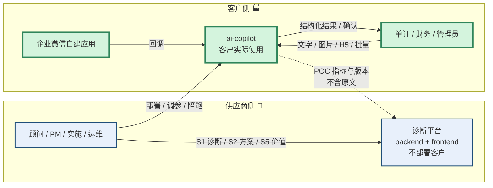
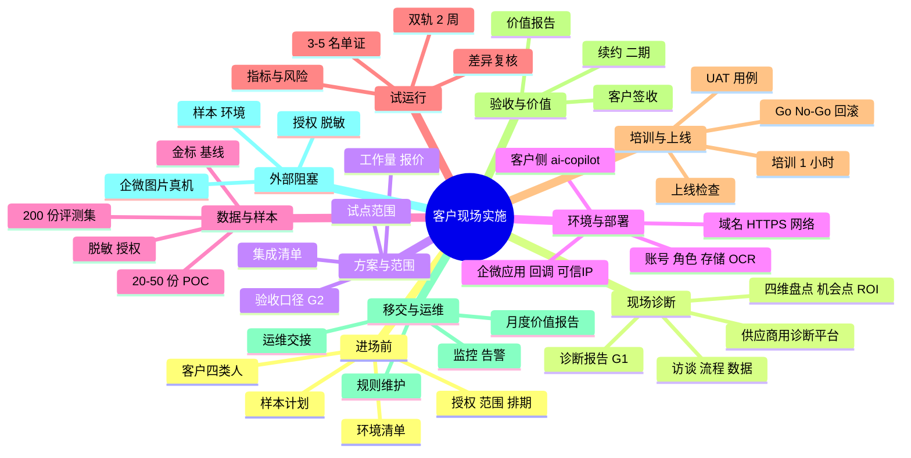
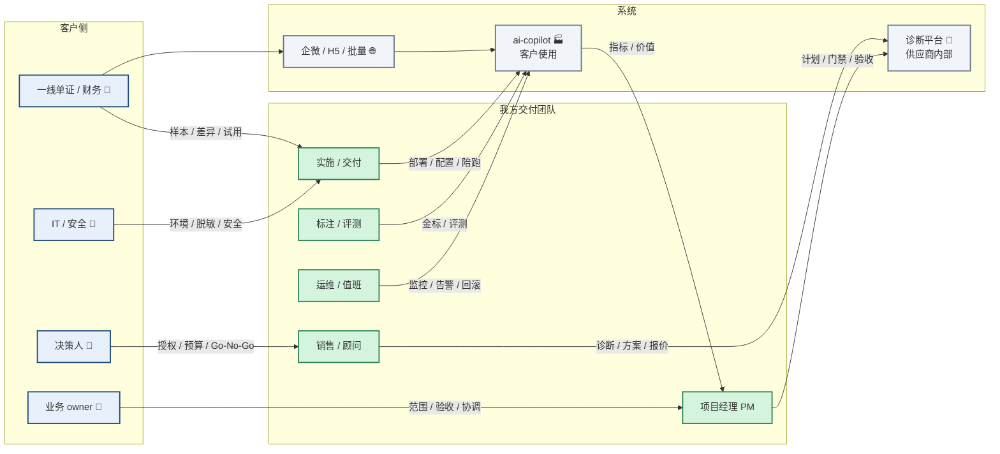
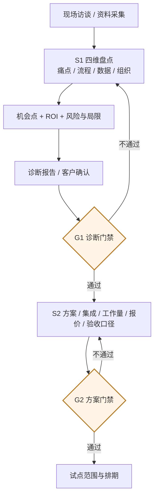
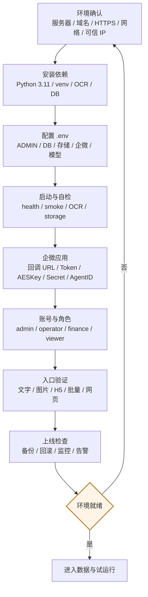
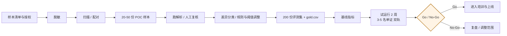
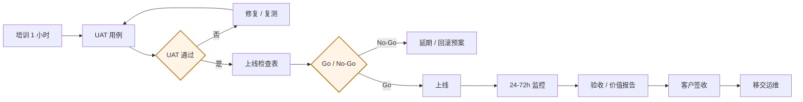

# Enterprise AI 客户现场实施全景图

> **版本**：v2.12 ｜ **更新**：2026-11-13 ｜ **基线**：`12ddead`
>
> **定位**：本文件只描述**客户方现场实施阶段**：进场前准备 → 现场诊断 → 方案与范围 → 环境部署 → 数据与样本 → 试运行 → 培训上线 → 验收价值 → 移交运维。
>
> **不包含**：产品开发、CI、发布、架构选型、多租户/HA 运行底座。这些在 `内部开发与发布.md`。
>
> **系统边界（最容易搞错）**：诊断平台（`backend/` + `frontend/`）是**供应商内部工具，不部署到客户，客户不登录、不使用**；客户现场只部署和使用 **`ai-copilot`**。供应商在现场用诊断平台完成 S1 诊断、S2 方案、S5 价值核算。
>
> **HTML 版**：`实施全景图.html` 由 `scripts/build_impl_map.py` 从本文件生成，**不要手改 HTML**。HTML 会把 `[x]` / `[ ]` 渲染成复选框，并支持“只看未完成 / 只看已完成”。
>
> **适用**：供应商交付团队、客户项目组、客户 IT / 安全。

---

## 0. 铁律（摘要；权威与执行细节见 `AGENTS.md` §0）

> **规则权威是 `AGENTS.md`**。本节只保留摘要；改规则先改 `AGENTS.md`，再同步本节，避免两处漂移。
> **机械化**：`make preflight`；本地 `make install-hooks`；CI frontend job 运行同一脚本。

1. **图先于改**：任何现场实施动作、配置、文档变更，开工前先在本图定位受影响节点；提交前再复核一次。
2. **同一提交更新**：现场记录、配置、文档、状态、证据必须同一次提交更新。
3. **完成只认证据**：`[x]` 必须有现场照片、签到、客户签字、截图、命令输出或工单记录；口头“应该没问题”不算。
4. **外部项不冒充**：真实客户、真实环境、真实企微、真实样本未验证的，保持 `[ ]` / 🟡，不得写成已完成。
5. **不包装 AI**：OCR、规则、脚本、人工复核、指标计算都是系统能力，不是大模型；合成样本必须标注“合成”。
6. **无影响也要留痕**：判断本次改动不影响本图时，提交说明写 `图无影响：<原因>`。
7. **每次发布更新**：更新顶部日期/基线、受影响节点、`VERIFICATION.md` 对应章节。
8. **HTML 不手改**：改完 MD 必须 `make impl-map` 重新生成。
9. **系统边界不混**：诊断平台不装客户、不给客户账号；客户只使用 ai-copilot。

> 违反以上任一条，视为变更未完成，**不得合并、不得推送**。内部开发/CI 规则见 `AGENTS.md` 与 `内部开发与发布.md`。

---

## 1. 图例与状态定义

| 标识 | 含义 | 判定标准 |
|---|---|---|
| ✅ | 已完成且有证据 | 现场记录 / 客户签字 / 命令通过 / 截图 |
| 🟡 | 有准备，但外部未验证 | 需要真实客户、真实环境或第三方 |
| ⬜ | 未开始 | 无实施动作或无证据 |
| ⛔ | 阻塞 / 明确不做 | 依赖缺失或不在本期范围 |
| 🔁 | 持续运行 | 每日 / 每周 / 每月执行 |
| 🧍 | 人工确认点 | 必须有人复核或签字 |
| 🤖 | 大模型参与 | 仅限明确标注节点；规则不算 |
| ⚙️ | 规则 / 脚本 / 系统 | 不是 AI |

**系统标记**：

| 标记 | 含义 |
|---|---|
| 🏢 供应商 | 供应商内部使用，不部署到客户 |
| 🏭 客户 | 部署在客户环境，客户实际使用 |
| 🌐 双方 | 企微 / H5 / 浏览器等入口 |

---

## 2. 系统边界：谁用哪个系统



| 系统 | 谁使用 | 部署位置 | 客户是否登录 | 现场用途 | 明确不做 |
|---|---|---|---|---|---|
| 诊断平台 `backend/` + `frontend/` | 供应商顾问 / PM / 实施 | 供应商 SaaS / 本机 | **否** | S1 诊断、S2 方案、S5 价值、POC 回写 | 不装客户、不给客户账号 |
| `ai-copilot` | 客户单证 / 财务 / 管理员；供应商实施 | 客户服务器 / 客户可访问云 | **是** | 托书识别、确认、指标、学习 | 不承担供应商项目管理 |
| 企业微信自建应用 | 客户员工 | 企业微信 + `ai-copilot` 回调 | 是（员工） | 文字 / 图片入口 | 不读已有聊天、不做会话存档 |

> 一句话：**两个系统。一个我们用来管项目，不装给客户；一个是客户用的 AI 应用，装这个。**
> 详细边界与落地 WBS 见 `会客包/12_系统边界与落地清单.md`。

**两个“经营洞察”必须分开说**（2026-11-07 补充）：

| 名称 | 位置 | 口径 | 客户是否可见 |
|---|---|---|---|
| S5 · 经营洞察 | 诊断平台 🏢 | 供应商在诊断/交付阶段对**客户项目**的判断：指标达标、续约风险、机会点前置条件 | **否** |
| 客户侧经营洞察 | 客户侧（**通用原型，真实数据未接**） | 上线后客户自己长期看：营收、成本、毛利、回款、异常、AI 贡献；`/insight` 已做规则汇总 + 可选 AI 解读（AI-40/53），输入仍是合成应收/费用/台账 | 是（P2，真实结论待客户数据） |
| 客户侧能源/线路决策 | 客户侧（**演示原型，合成运营数据**） | 油/电、大/小马力、线路成本、空驶、人力工时对比；`/fleet` 读取公开资料缓存 + 合成数据，规则测算 + 可选 AI 解读（AI-54） | 是（演示，真实结论待客户能耗/TCO/工时数据） |
| 客户侧经营驾驶舱 | 客户侧（**演示样张，合成数据**） | 老板视图：经营结果、客户/线路、能源/线路快照 + 先看几件事 + 数据接入状态；`/dashboard` 聚合三个独立演示模块，明确不可加总（AI-55） | 是（演示，真实结论待客户数据） |

客户侧现在还有**运行指标 / 月报 / 风险模拟**，属于运营指标，不是经营洞察；客户侧经营洞察的前置仍是成本归集与 TMS/财务数据打通。AI 解读只负责把规则指标翻成简报、排序和动作草稿，不改数。能源/线路决策的公开资料只用于会前研究，运营数据是合成的，且未计车辆折旧/充电设施，不能当采购结论。

---

## 3. 总览脑图



---

## 4. 现场实施主线（约 6–7 周）

```mermaid
flowchart LR
  P0[进场前 T-14~T-1<br/>授权 / 范围 / 环境清单] --> P1[W1 现场启动会<br/>四类人到场]
  P1 --> S1[W1-W2 S1 现场诊断<br/>供应商用诊断平台]
  S1 --> G1{G1 诊断确认}
  G1 -->|客户确认| S2[W2 S2 方案与试点范围<br/>供应商用诊断平台]
  G1 -->|未确认| PX[暂停 / 补资料]
  S2 --> G2{G2 方案确认}
  G2 -->|确认| D1[W2-W3 环境与部署<br/>客户侧 ai-copilot]
  G2 -->|未确认| PX
  D1 --> D2[W3-W4 数据与样本<br/>脱敏 / 200 份 / 金标]
  D2 --> POC[W5-W6 试运行<br/>3-5 名单证 双轨 2 周]
  POC --> G3{G3 试运行 Go/No-Go}
  G3 -->|Go| T1[W6 培训 / UAT / 上线检查]
  G3 -->|No-Go| PZ[复盘 / 调整范围]
  T1 --> G4{G4 上线门禁}
  G4 -->|通过| L1[上线 / 24-72h 保障]
  G4 -->|不通过| T1
  L1 --> A1[验收 / 价值报告 / 签收]
  A1 --> G5{G5 价值确认}
  G5 --> H1[移交运维 / 续约或二期]

  classDef done fill:#d4f4dd,stroke:#2f855a,stroke-width:2px
  classDef gate fill:#fff4e5,stroke:#b7791f,stroke-width:2px
  classDef todo fill:#f1f5f9,stroke:#94a3b8,stroke-width:2px,stroke-dasharray:3 3
  class P0,P1 done
  class G1,G2,G3,G4,G5 gate
  class S1,S2,D1,D2,POC,T1,L1,A1,H1,PX,PZ todo
```



**读图要点**

- **诊断平台只在供应商侧**：S1/S2 的诊断与方案由供应商完成，客户只看报告、做确认。
- **客户侧只装 ai-copilot**：环境、部署、账号、企微入口、备份、监控都在这一条线上。
- **没有样本不试运行**：合成样例只能做演示，不能替代客户真实托书。
- **没有验收口径不上线**：先定指标、目标、测量方法、责任人，再谈上线。
- **没有回滚预案不上线**：上线前必须演一次恢复或回退。

---

## 5. 角色协作泳道



**协作硬规则**

- 客户侧必须有一个**总协调 owner**，负责找齐业务 owner、一线骨干、IT、安全四类人。
- 我方 PM 对计划与验收负责；实施对部署与上线负责；运维对监控与回滚负责；标注/评测对金标质量负责。
- **诊断平台账号只在我方团队内**；客户看报告、做确认，不登录诊断平台。
- 任何跨角色交接都必须有**书面输入/输出**（模板、确认单、会议纪要、系统记录），不能只在聊天里说。

---

## 6. 现场诊断流程（供应商使用诊断平台）



| 阶段 | 供应商做什么 | 客户做什么 | 产出 | 系统 |
|---|---|---|---|---|
| S1 现场诊断 | 访谈、流程梳理、四维盘点、机会点与 ROI | 提供资料、接受访谈、确认痛点 | 诊断报告、G1 确认 | 诊断平台 🏢 |
| S2 方案与范围 | 方案、集成清单、工作量、报价、验收口径 | 确认范围、预算、验收标准 | 方案书、报价、G2 确认 | 诊断平台 🏢 |
| S5 价值核算 | 指标字典、目标、快照、价值报告 | 提供运营数据、确认口径 | 价值报告、续约建议 | 诊断平台 🏢 |

**边界与纪律**

- 诊断平台**不部署到客户服务器**，也不给客户开账号；客户确认的是报告和范围，不是系统。
- 访谈记录、诊断报告、报价在导出给客户前必须脱敏；真实联系人、合同价、内部成本不得外发。
- G1/G2 不是文档检查，是**系统校验 + 客户书面确认**；只有系统校验没有客户确认，不能算通过。
- 诊断结论必须区分：**事实**（客户原话/数据）、**判断**（我方分析）、**假设**（待验证）。不得把假设写成结论。

---

## 7. ai-copilot 现场部署流程（客户侧）

> **客户看到的系统名是「智单」**：登录页标题、左侧菜单品牌名都用中文。仓库目录、服务名、环境变量仍是 `ai-copilot`，部署命令与运维手册不用改；培训、截图、口头讲解统一说「智单」。



### 7.1 三种部署形态

| 形态 | 模型在哪 | OCR 在哪 | 适用 |
|---|---|---|---|
| A. 供应商云上托管（单租户实例） | 境内模型 API | 供应商服务器 | 小客户，最快 |
| B. 客户内网私有化 | 客户 GPU + 本地模型 | 客户服务器 | 大客户、数据敏感 |
| **C. 混合（推荐）** | 境内模型 API（脱敏后调用） | **客户内网** | 大多数集卡客户 |

> C 最划算：票据图片不出内网，只送脱敏文本给模型。选型必须在进场前和客户 IT 确认，不能到现场再改。

### 7.2 部署必查项

| 项 | 要求 | 检查方法 |
|---|---|---|
| 服务器 | CPU / 内存 / 磁盘满足 OCR 与并发 | `free -h`、`df -h` |
| 域名与 HTTPS | 固定域名、有效证书；企微回调必须 HTTPS | 浏览器 / `curl -I` |
| 网络 | 客户内网到模型网关、企微 API 可达 | `curl` 目标地址 |
| 可信 IP | 企微应用配置出口 IP | 企微后台截图 |
| Python | 3.11 + `.venv`，不用系统 Python | `python -V` |
| OCR | RapidOCR / onnxruntime 可用 | `/api/health` 的 `ocr_ready` |
| 数据库 | SQLite 或 PostgreSQL；多实例必须 PostgreSQL | `DATABASE_URL` |
| 存储 | local 或 S3；多实例必须共享存储 | 上传后另一实例可读 |
| 账号 | admin 首登改密；四角色按需开通 | `/users` |
| 备份 | 每日备份 + 恢复演练 | 备份文件 + 恢复记录 |
| 监控 | `/metrics` 可抓取；日志可查 | Prometheus / 日志 |
| 回滚 | 上一版本可启动；数据迁移可回退 | 回滚演练记录 |

### 7.3 关键环境变量

```env
# 管理员与数据库
ADMIN_EMAIL=admin@客户域名
ADMIN_PASSWORD=首次登录后立即修改
DATABASE_URL=postgresql://...            # 单机可留空用 SQLite
DB_PATH=data/app.db

# 企微入口
WECOM_TOKEN=企微后台 Token
WECOM_CORPID=企业 CorpID
WECOM_ENCODING_AES_KEY=43 位 Key
WECOM_SECRET=应用 Secret                 # 图片下载与主动推送
WECOM_AGENTID=应用 AgentId
WECOM_IMAGE_MAX_MB=10

# 存储与模型（可选）
STORAGE_BACKEND=local                    # local / s3
LLM_BASE_URL=...
LLM_API_KEY=...                          # 留空 = 纯规则
LLM_MODEL=...
```

> 真实值只写客户环境的 `.env`，不提交仓库、不发聊天、不截图外传。

---

## 8. 数据、样本与试运行



**样本规则**

- 样本必须有**来源、数量、字段、授权状态、脱敏方式**；没有授权的样本不进场。
- 合成样本必须显式标注“合成 / 演示”；**合成准确率不能当客户真实准确率**。
- 金标标的是**原文写了什么**，不是业务上“应该是什么”；箱号校验失败也不改金标原值。
- POC 先跑 20–50 份，差异复核后再扩到 200 份；不要一上来跑全量。
- 试运行必须**双轨**：旧流程继续跑，新系统并行；否则无法比较节省与错误。
- 指标至少包括：字段准确率、整单准确率、绕过率、自动通过率、人工修正率、单均耗时、节省工时。

---

## 9. 培训、上线、验收与移交



### 9.1 培训

| 对象 | 内容 | 时长 | 考核 |
|---|---|---|---|
| 单证员 | 左侧菜单导览、企微发文字/图片、H5 拍照、批量导入、确认/改单 | 45 分钟 | 独立完成 3 单 |
| 财务 | 费用检查、自动对账/对账复核、外协结算、账龄催收、导出 | 30 分钟 | 独立完成 1 单 |
| 管理员 | 用户与角色、阈值、学习队列、备份/监控 | 30 分钟 | 能建账号、能看指标 |

> 培训统一叫「**智单**」，入口按左侧菜单讲解；诊断平台不进入客户培训。
| 客户 IT | 部署结构、日志、备份、回滚、告警 | 30 分钟 | 能按手册重启/恢复 |

### 9.2 上线门禁（G4）

| 项 | 必须有 | 没有就 |
|---|---|---|
| UAT | 用例、结果、客户签字 | 不上线 |
| P0/P1 缺陷 | 全部关闭或有客户接受的替代方案 | 不上线 |
| 回滚 | 上一版本、回滚步骤、回滚窗口 | 不上线 |
| 监控 | 错误率、P95、失败批次、企微图片指标 | 不上线 |
| 培训 | 签到表 + 操作说明 | 不上线 |
| 签收 | 上线检查表客户签字 | 不上线 |

### 9.3 验收与价值（G5）

| 项 | 内容 | 证据 |
|---|---|---|
| 验收口径 | 指标、目标、测量方法、责任人 | 双方确认单 |
| 价值报告 | 节省工时、修正率、绕过率、风险拦截 | 可追溯快照 |
| 客户签收 | 验收报告签字/邮件 | 签字件 |
| 续约/二期 | 下一阶段范围与建议 | 会议纪要 |

### 9.4 移交清单

- 运维手册、部署手册、回滚步骤、备份恢复记录。
- 管理员账号、角色清单、密码策略、离职/转岗处理。
- 监控面板、告警接收人、值班表（真实联系人**不提交仓库**）。
- 月度价值报告节奏、规则维护窗口、版本回归计划。
- 数据留存期限、导出/删除流程、合同到期后的数据处理约定。

---

## 10. 现场实施检查表

> 状态说明：`[x]` 有证据；`[ ]` 未完成或外部未验证。每项右侧写证据或命令，禁止空勾。
> 本表只覆盖客户现场实施；开发/CI/架构证据见 `内部开发与发布.md`。

### 10.1 进场前准备（PREP）

| ID | 检查项 | 状态 | 证据 / 验收 |
|---|---|---|---|
| PREP-01 | 现场实施清单模板（本图 §10） | [x] | 本文件 |
| PREP-02 | 环境清单模板（本图 §7.2） | [x] | 本文件 |
| PREP-03 | 数据需求与金标模板 | [x] | `会客包/试点一/01_数据需求清单.xlsx`、`02_金标标注模板.xlsx` |
| PREP-04 | 培训材料与操作说明 | [x] | `会客包/托书结构化试用指南.md`（智单界面导览 + 对账/账龄试用 + 3 张截图）、`ai-copilot/docs/运维手册.md` |
| PREP-05 | 上线检查/回滚模板 | [x] | 本图 §9.2、`ai-copilot/docs/运维手册.md` |
| PREP-06 | 验收/价值报告模板 | [x] | `会客包/12_系统边界与落地清单.md` §八 |
| PREP-07 | 客户四类人名单与联系方式 | [ ] | 客户确认单 |
| PREP-08 | 进场排期、场地、网络、门禁 | [ ] | 邮件/会议纪要 |
| PREP-09 | 客户授权与项目范围确认 | [ ] | 签字/邮件/确认单 |
| PREP-10 | 数据处理与脱敏约定 | [ ] | 数据清单 + 脱敏规则 |
| PREP-11 | 环境预检结果 | [ ] | 服务器/域名/网络检查表 |

### 10.2 现场诊断（DIA）— 供应商使用诊断平台

| ID | 检查项 | 状态 | 证据 / 验收 |
|---|---|---|---|
| DIA-01 | 现场启动会，四类人到场 | [ ] | 签到表 + 会议纪要 |
| DIA-02 | 业务访谈记录 | [ ] | 访谈记录 |
| DIA-03 | 业务流程与数据盘点 | [ ] | 流程图 + 数据清单 |
| DIA-04 | 四维盘点（痛点/流程/数据/组织） | [ ] | 诊断平台记录 |
| DIA-05 | 机会点、ROI、风险与局限 | [ ] | 诊断平台记录 |
| DIA-06 | 诊断报告导出并脱敏 | [ ] | 报告文件 + 脱敏检查 |
| DIA-07 | G1 客户确认 | [ ] | 签字/邮件 |
| DIA-08 | 确认诊断平台不部署客户、不给客户账号 | [x] | 本图 §2、`会客包/12_系统边界与落地清单.md` |
| DIA-09 | 诊断结论区分事实/判断/假设 | [ ] | 报告审阅记录 |

### 10.3 方案与范围（PLAN）

| ID | 检查项 | 状态 | 证据 / 验收 |
|---|---|---|---|
| PLAN-01 | 试点范围与不在范围清单 | [ ] | 方案书 |
| PLAN-02 | 集成清单（企微/TMS/SSO/存储） | [ ] | 集成清单 |
| PLAN-03 | 工作量与人天 | [ ] | 方案书 |
| PLAN-04 | 报价与付款节点 | [ ] | 报价单 |
| PLAN-05 | 验收口径（指标/目标/测量/责任人） | [ ] | 双方确认单 |
| PLAN-06 | G2 客户确认 | [ ] | 签字/邮件 |
| PLAN-07 | 里程碑与排期（6–7 周） | [ ] | 项目计划 |
| PLAN-08 | 退出条件与回滚边界 | [ ] | 合同/方案附件 |

### 10.4 环境与部署（DEP）— 客户侧 ai-copilot

| ID | 检查项 | 状态 | 证据 / 验收 |
|---|---|---|---|
| DEP-01 | 服务器/云资源就绪 | [ ] | 配置截图 |
| DEP-02 | 固定域名 + HTTPS 证书 | [ ] | `curl -I` 输出 |
| DEP-03 | 网络与防火墙放通 | [ ] | 连通性测试 |
| DEP-04 | 企微可信 IP 配置 | [ ] | 企微后台截图 |
| DEP-05 | Python 3.11 + `.venv` + 依赖 | [ ] | `python -V`、`pip list` |
| DEP-06 | 数据库就绪（SQLite/PostgreSQL） | [ ] | 连接测试 |
| DEP-07 | 存储就绪（local/S3；仅多副本时需要共享） | [ ] | 上传/读取测试 |
| DEP-08 | `.env` 配置完成且不入库 | [ ] | 配置清单（脱敏） |
| DEP-09 | 启动成功，`/api/health` 200 | [ ] | 命令输出 |
| DEP-10 | `scripts/smoke.sh` 16/16 | [ ] | smoke 输出 |
| DEP-11 | OCR 可用（`ocr_ready=true`） | [ ] | health JSON |
| DEP-12 | 企微应用创建并配置回调 | [ ] | 后台截图 |
| DEP-13 | 企微安全模式（Token/AESKey/CorpID） | [ ] | 回调验证 |
| DEP-14 | 企微图片通道（Secret/AgentID） | [ ] | 真机发图 + 主动推送 |
| DEP-15 | 四角色账号与密码策略 | [ ] | `/users` 截图 |
| DEP-16 | 入口验证：文字/图片/H5/批量/网页 | [ ] | 每个入口一条记录 |
| DEP-17 | 备份与恢复演练 | [ ] | 备份文件 + 恢复记录 |
| DEP-18 | 监控、日志、指标可查 | [ ] | `/metrics` + 日志 |
| DEP-19 | 回滚预案与回滚窗口 | [ ] | 回滚演练记录 |
| DEP-20 | 多副本共享 `data/batches` 或 S3（仅多副本部署时） | [ ] | 跨实例读取测试 |

### 10.5 数据与样本（DATA）

| ID | 检查项 | 状态 | 证据 / 验收 |
|---|---|---|---|
| DATA-01 | 数据清单与授权 | [ ] | 数据清单 + 授权 |
| DATA-02 | 脱敏规则确认 | [ ] | 脱敏规则 + 抽检 |
| DATA-03 | 20–50 份 POC 样本 | [ ] | 样本清单 |
| DATA-04 | `gold.csv` 金标 | [ ] | 标注记录 |
| DATA-05 | 200 份评测集 | [ ] | 样本清单 + 评测记录 |
| DATA-06 | 合成样本已标注“合成” | [x] | `ai-copilot/samples/bookings.jsonl` 标注 |
| DATA-07 | 基线指标（字段/整单/耗时） | [ ] | 评测报告 |

### 10.6 试运行（POC）

| ID | 检查项 | 状态 | 证据 / 验收 |
|---|---|---|---|
| POC-01 | 3–5 名单证员参与 | [ ] | 名单 + 签到 |
| POC-02 | 双轨运行 2 周 | [ ] | 日报/周报 |
| POC-03 | 差异复核记录 | [ ] | 差异清单 |
| POC-04 | 规则/阈值调整记录 | [ ] | 变更记录 |
| POC-05 | 指标：字段/整单/绕过率/修正率/节省工时 | [ ] | 指标截图 |
| POC-06 | 风险与局限清单 | [ ] | 风险登记册 |
| POC-07 | Go/No-Go 结论 | [ ] | 签字/会议纪要 |

### 10.7 培训与上线（GOL）

| ID | 检查项 | 状态 | 证据 / 验收 |
|---|---|---|---|
| GOL-01 | 培训完成（单证/财务/管理员/IT） | [ ] | 签到表 |
| GOL-02 | 一页操作说明交付 | [ ] | 文档 |
| GOL-03 | UAT 用例执行并通过 | [ ] | UAT 报告 |
| GOL-04 | 上线检查表签字 | [ ] | 签字件 |
| GOL-05 | 回滚窗口与责任人确认 | [ ] | 上线方案 |
| GOL-06 | 上线 Go/No-Go | [ ] | 决策记录 |
| GOL-07 | 上线后 24–72h 监控 | [ ] | 监控截图 |
| GOL-08 | 问题清单闭环 | [ ] | 工单/问题表 |

### 10.8 验收与价值（ACC）

| ID | 检查项 | 状态 | 证据 / 验收 |
|---|---|---|---|
| ACC-01 | 验收口径复核（与 PLAN-05 一致） | [ ] | 验收报告 |
| ACC-02 | 价值报告（节省/修正/绕过/风险） | [ ] | 报告文件 |
| ACC-03 | 客户签收 | [ ] | 签字/邮件 |
| ACC-04 | 续约/二期建议 | [ ] | 会议纪要 |

### 10.9 移交与运维（OPS）

| ID | 检查项 | 状态 | 证据 / 验收 |
|---|---|---|---|
| OPS-01 | 运维手册与部署手册交接 | [ ] | 签收单 |
| OPS-02 | 管理员账号、角色、密码策略移交 | [ ] | 账号清单（脱敏） |
| OPS-03 | 备份/恢复责任人确认 | [ ] | 运维交接单 |
| OPS-04 | 监控/告警责任人确认 | [ ] | 值班表（不入库） |
| OPS-05 | 月度价值报告节奏 | [ ] | 服务计划 |
| OPS-06 | 规则维护/版本回归计划 | [ ] | 维护计划 |
| OPS-07 | 数据留存、导出、删除约定 | [ ] | 合同/附件 |

### 10.10 外部输入（EXT）

| ID | 输入 | 状态 | 验收证据 | 负责人 |
|---|---|---|---|---|
| EXT-01 | 客户授权与项目范围确认 | [ ] | 签字 / 邮件 / 确认单 | 客户项目负责人 |
| EXT-02 | 数据处理与脱敏约定 | [ ] | 数据清单 + 脱敏规则 | 客户安全/法务 + 我方 |
| EXT-03 | 真实机会点 1 个 | [ ] | 机会点编号、访谈记录、基线 | 顾问 |
| EXT-04 | 真实样本（POC） | [ ] | 来源、数量、字段、访问状态 | 客户业务 |
| EXT-05 | 接口人与排期 | [ ] | 周会节奏、评审窗口 | 客户 PM |
| EXT-06 | 试点环境 | [ ] | 域名、网络、账号、回滚窗口 | 客户 IT / 我方运维 |
| EXT-07 | 验收口径 | [ ] | 指标、目标、测量方法、责任人 | 双方 |
| EXT-08 | 200 份脱敏托书 + `gold.csv` | [ ] | 样本清单 + 标注记录 | 客户一线 + 标注 |
| EXT-09 | POC 运行记录 + 人工复核 | [ ] | run_no、配置、指标、复核人 | 我方 + 客户 |
| EXT-10 | UAT 报告 + 上线检查表签收 | [ ] | 客户签字 | 客户业务 owner |
| EXT-11 | 上线后 24–72h 监控记录 | [ ] | 错误率、P95、导出失败 | 我方运维 |
| EXT-12 | 价值报告 + 续约/二期建议 | [ ] | 可追溯快照/价值记录 | 我方 + 客户 |
| EXT-13 | 企微图片通道：应用 Secret / AgentID / 可信 IP / 固定域名 | 🟡 | 测试租户已完成 Secret/AgentID/可信 IP + 真机图文；**固定域名未做**（回调仍为 `trycloudflare` 临时地址） | 客户 IT / 企微管理员 |

### 10.11 交付能力摘要（现场可用性）

> 本表只回答“现场能不能用”；详细开发证据与状态见 `内部开发与发布.md` §3.3。

| 能力 | 现场可用性 | 说明 |
|---|---|---|
| 企微文字消息 | ✅ | 已支持安全模式、分条录入、确认入库 |
| 企微图片消息 | ✅ | 2026-11-07 测试租户真实端到端通过：真机发图 → 回执 → OCR → 主动推送；**临时隧道**，固定域名见 EXT-13 |
| H5 拍照/上传 | ✅ | 系统文件选择器/相机，不做网页内实时预览 |
| 网站粘贴/上传 | ✅ | 临时试用入口 |
| 批量导入 PNG/PDF/TXT | ✅ | 200 文件、单文件 ≤10MB；默认规则 + 脱敏 |
| OCR + 规则抽取 | ✅ | RapidOCR + 规则；数字级误识仍需人工复核 |
| 模型补空 | 🟡 | `fill_only`，失败回退规则；真实模型联调未验证 |
| 分级审批 / 人工确认 | ✅ | single / double / blocked，改单留痕 |
| 学习队列 / 金标 | ✅ | 标注、导出 JSONL；真实样本 0 份 |
| 指标与价值 | ✅ | 绕过率、自动通过率、修正率、节省工时 |
| 回写诊断平台 | ✅ | 仅指标与版本，不含原文；幂等 + 重试 |
| 客户侧经营洞察 | ⛔ | **真实数据未接（P2）**；`/insight` 通用原型已有规则汇总 + 可选 AI 解读（AI-40/53），输入为合成应收/费用/台账；真实营收/成本/毛利/单车盈利仍需成本归集 + TMS/财务数据；现有运行指标/月报仍只是运营指标 |
| 能源/线路决策 | 🟡 | **演示版（AI-54）**；`/fleet` 用公开资料 + 合成运营数据对比油/电、大/小马力、空驶、人力工时；成本参数为示例假设，未计车辆折旧/充电设施；真实结论需客户能耗、TCO、工时、路桥和合同价 |
| 经营驾驶舱 | 🟡 | **演示样张（AI-55）**；`/dashboard` 聚合经营结果/客户线路/能源线路三个独立合成模块，明确“不可加总”；真实数据未接，AI 摘要只做解读 |
| TMS 写回 | ⛔ | **未实现（C2）**；需客户 TMS 接口文档；当前退路是 CSV 导出、人工回填 |
| 个人微信 / 会话内容存档 | ⛔ | 个人微信无官方接口；会话存档需许可/授权/密钥/合规，当前不做 |

---

## 11. 角色 RACI（谁负责、谁拍板）

> R = 执行；A = 最终负责/拍板；C = 需咨询；I = 需知会。

| 活动 | 客户决策人 | 客户业务 owner | 客户一线 | 客户 IT/安全 | 销售/顾问 | 我方 PM | 实施/交付 | 运维 | 标注/评测 |
|---|---|---|---|---|---|---|---|---|---|
| 授权 / 预算 | A | C | I | C | R | I | I | I | I |
| 范围 / 验收口径 | A | R | C | C | C | R | C | I | I |
| 现场诊断 | I | A | C | I | R | C | I | I | I |
| 方案 / 报价 | A | C | I | I | R | R | C | I | I |
| 环境 / 部署 | I | I | I | A | I | C | R | C | I |
| 样本 / 脱敏 | I | A | R | C | I | C | C | I | C |
| 试运行 / POC | I | A | R | C | C | R | R | I | C |
| 培训 / UAT / 上线 | A | R | R | C | I | A | R | C | I |
| 监控 / 告警 | I | I | I | C | I | C | C | R/A | I |
| 验收 / 价值 | A | R | C | I | R | C | C | I | I |
| 移交 / 运维 | I | C | I | A | I | R | C | R | I |

**硬规则**

- 每行只能有一个 `A`；没有 `A` 的活动不允许启动。
- 客户侧 `A` 不落地时，项目只能停在“方案/样例”，不能进入“真实试点/上线”。
- 标注/评测的 `A` 不能由写规则/提示词的人兼任，避免自己标自己。
- 诊断平台的账号与操作权限只在我方；客户不登录诊断平台。

---

## 12. 现场运行节奏

| 时点 | 动作 | 负责 | 证据 |
|---|---|---|---|
| T-14 | 授权、范围、环境清单、样本计划 | PM | 确认单 |
| T-7 | 四类人确认、排期、网络/门禁 | PM + 客户 | 会议纪要 |
| T-1 | 环境预检、回滚预案、物料检查 | 实施 | 检查表 |
| 现场每日 | 站会、问题清单、风险登记 | PM | 日会纪要 |
| 每周 | 诊断/试运行复盘、指标复核 | PM + 客户 owner | 周报 |
| 上线 24–72h | 监控、问题闭环、回滚待命 | 运维 | 监控截图 |
| 验收后 | 移交、月度价值报告、规则维护 | PM + 运维 | 签收/报告 |

---

## 13. 常见实施错误（防再犯）

| # | 错误做法 | 正确做法 |
|---|---|---|
| 1 | 把诊断平台装到客户服务器 | 诊断平台只在我方，不部署客户 |
| 2 | 给客户开诊断平台账号 | 客户只看报告、做确认；账号只在我方 |
| 3 | 把诊断平台页面当客户交付物演示（典型：客户老板版 PPT 放 S5 经营洞察截图） | 客户侧只演示 ai-copilot；S5 经营洞察是供应商内部诊断口径，客户不登录，且截图会带出「平台租户 / 协作审计 / 报价 / 续约风险」等内部信息。**2026-11-07 已删除该页（14→13 页）** |
| 4 | 没有授权/脱敏就收样本 | 先签授权与脱敏约定，再收样本 |
| 5 | 没有验收口径就上线 | 先定指标、目标、测量、责任人 |
| 6 | 没有回滚预案就上线 | 先演一次恢复/回退 |
| 7 | 拿合成样本准确率当客户真实准确率 | 标注“合成”，用客户 200 份样本重跑 |
| 8 | 把 OCR/规则说成大模型 | 按系统能力讲，只有 `fill_only` 标 🤖 |
| 9 | 企微图片未配 Secret/AgentID 就承诺可用 | 先配通道并真机验证；否则明确走 H5 |
| 10 | 只配临时隧道就上线 | 固定域名 + 可信 IP + HTTPS |
| 11 | 多实例不共享存储 | 共享 `data/batches` 或用 S3 |
| 12 | 只培训管理员，不培训一线 | 单证、财务、管理员、IT 都要培训 |

---

## 14. 相关文档

| 文档 | 关系 |
|---|---|
| `内部开发与发布.md` | 产品开发、CI、发布、架构、多租户/HA（内部，不发给客户） |
| `会客包/12_系统边界与落地清单.md` | 两个系统的边界、6–7 周落地 WBS、部署形态 |
| `ai-copilot/docs/运维手册.md` | 客户侧部署、配置、故障处理 |
| `ai-copilot/WECOM_BINDING.md` | 企微自建应用绑定与图片通道 |
| `会客包/托书结构化试用指南.md` | 客户试用与入口说明 |
| `VERIFICATION.md` | 全项目证据总账 |
| `AGENTS.md` | 协作铁律与验证顺序 |

---

## 15. 维护记录

| 版本 | 日期 | 基线 | 变更 |
|---|---|---|---|
| v2.12 | 2026-11-13 | `12ddead` | 新增经营驾驶舱演示样张（AI-55）：老板视图聚合经营结果/客户线路/能源线路；三模块独立合成、不可加总；真实数据待客户 |
| v2.11 | 2026-11-12 | `9f106be` | 新增客户侧能源/线路决策演示（AI-54）：公开资料 + 合成运营数据，油/电、大/小马力、空驶、人力工时对比；真实 TCO/能耗/工时待客户 |
| v2.10 | 2026-11-12 | `3e152c2` | 客户侧经营洞察口径更新：`/insight` 通用原型已有规则汇总 + 可选 AI 解读（AI-40/53），真实数据仍未接（AI-29）；AI 只解读，不改数 |
| v2.9 | 2026-11-08 | `b3acd66` | 待办边界清理：多租户只在诊断平台，客户侧单租户/一客一实例；部署形态改称「云上托管（单租户实例）」；多副本共享标注为仅多副本时 |
| v2.8 | 2026-11-08 | `d1dd702` | 企微图片通道在测试租户完成真实端到端（文字 + 图片 + 主动推送）；AI-07/AI-07E 转 `[x]`，EXT-13 转 🟡（固定域名未做），客户现场 DEP 检查项保持 `[ ]` |
| v2.7 | 2026-11-07 | `fa6b69a` | 培训材料按新界面重写：`会客包/托书结构化试用指南.md` 改名《智单 · 托书结构化试用指南》，新增左侧菜单导览与角色可见性、自动对账 / 账龄催收各 3 步试用与口径边界，配 3 张新截图；培训章节补菜单入口 |
| v2.6 | 2026-11-07 | `7a77d8a` | 客户老板版 PPT 第 5 页对账截图按新界面（左侧菜单栏）重抓，演示数据与实际一致（8 一致 / 2 金额不符 / 1 系统无此单 / 1 客户漏单）；新增可复用抓图脚本 `会客包/reports/capture_ui.mjs` |
| v2.5 | 2026-11-07 | `324df9b` | 客户侧界面中文名定为「智单」，桌面端改为左侧菜单栏（14 页统一，按角色隐藏入口）；部署名/环境变量仍为 ai-copilot |
| v2.4 | 2026-11-07 | `bba6fe1` | 客户老板版 PPT 第 2 页「算清账」口径校正：「续约风险」→「回款风险」（原为我方续约，属内部口径）；「能追到单据、客户、责任人」→「能追到单据、客户、账期」（系统无逐条负责人字段，账龄有账期与逾期天数） |
| v2.3 | 2026-11-07 | `515b80d` | 客户老板版 PPT 第 5 页文案校正：「把差异分到动作」→「分到处理决定」，「有负责人」→「有处理记录」；演示数据改为 8 条一致 / 2 条金额不符 / 1 条系统无此单 / 1 条客户漏单；明确对账匹配为规则、模型只在 `explain=true` 时解释 |
| v2.2 | 2026-11-07 | `5fc18a0` | 客户老板版 PPT 删除「从数据到结论（经营洞察）」页：该页用诊断平台 S5 截图，客户不登录且含内部报价/续约信息；页数 14→13，讲稿与页码同步，大模型页与四步路径改用「经营指标 / 月报」口径 |
| v2.1 | 2026-11-07 | `d983fa5` | 记录两个“经营洞察”的区别：S5 经营洞察为供应商内部诊断口径，客户侧经营洞察未实现（P2）；TMS 写回未实现（C2）；补充“客户 PPT 放诊断平台截图”的实施错误 |
| v2.0 | 2026-11-07 | `6586461` | 重构为**客户现场实施**单一事实源：移除开发/CI/架构阶段，移到 `内部开发与发布.md`；明确诊断平台不部署客户、客户只用 ai-copilot |
| v1.4 | 2026-11-07 | `74132b5` | 企微图片：media_id 下载、异步 OCR、主动推送、MsgId 幂等；自检 16/16 |
| v1.3 | 2026-11-07 | `202549f` | 铁律可执行化：preflight 脚本、Git hooks、CI 校验；规则权威归位 `AGENTS.md` |
| v1.2 | 2026-11-07 | `e87e65d` | 复核 v1.1 改动并推送；run #126 四 job 全绿 |
| v1.1 | 2026-11-07 | `e4e2b96` | 新增 CI 同步校验；run #125 四 job 全绿；CI-11 关闭 |
| v1.0 | 2026-11-07 | `c3b37ac` | 首版：脑图、阶段主线、角色泳道、发布闭环、AI 托书、多租户、客户试点、逐项检查表、RACI、铁律 |

> 下次复核：**每次现场实施变更**；至少每周一次全量核对。发现图与现场记录/证据不一致，先修图再继续实施。
