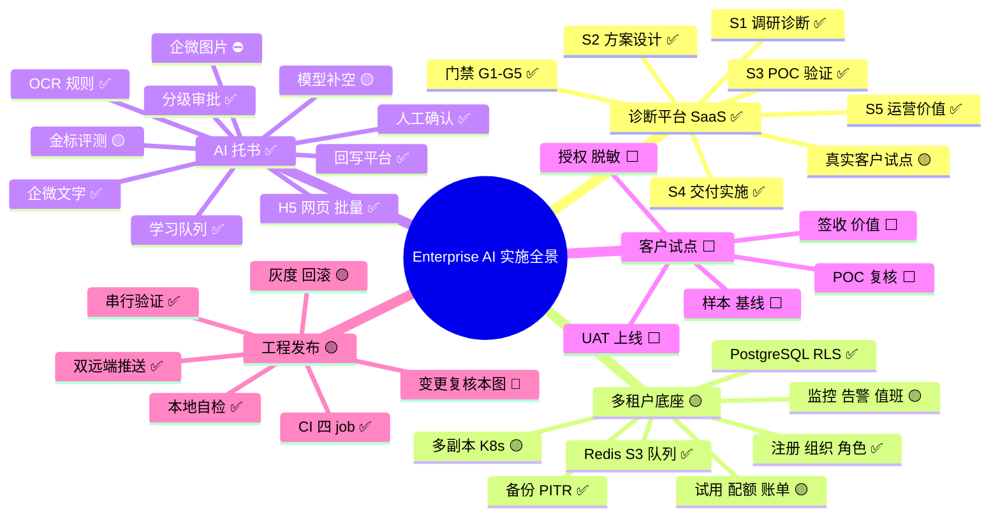
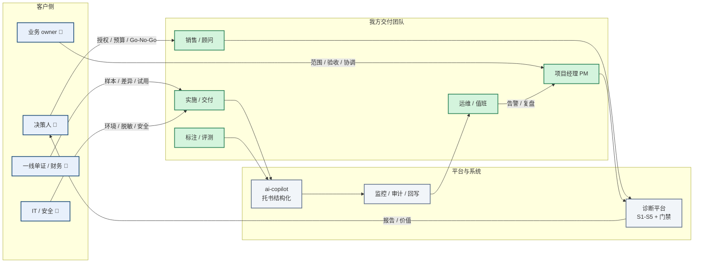
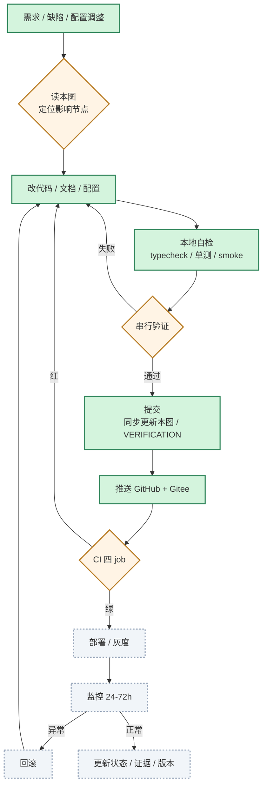
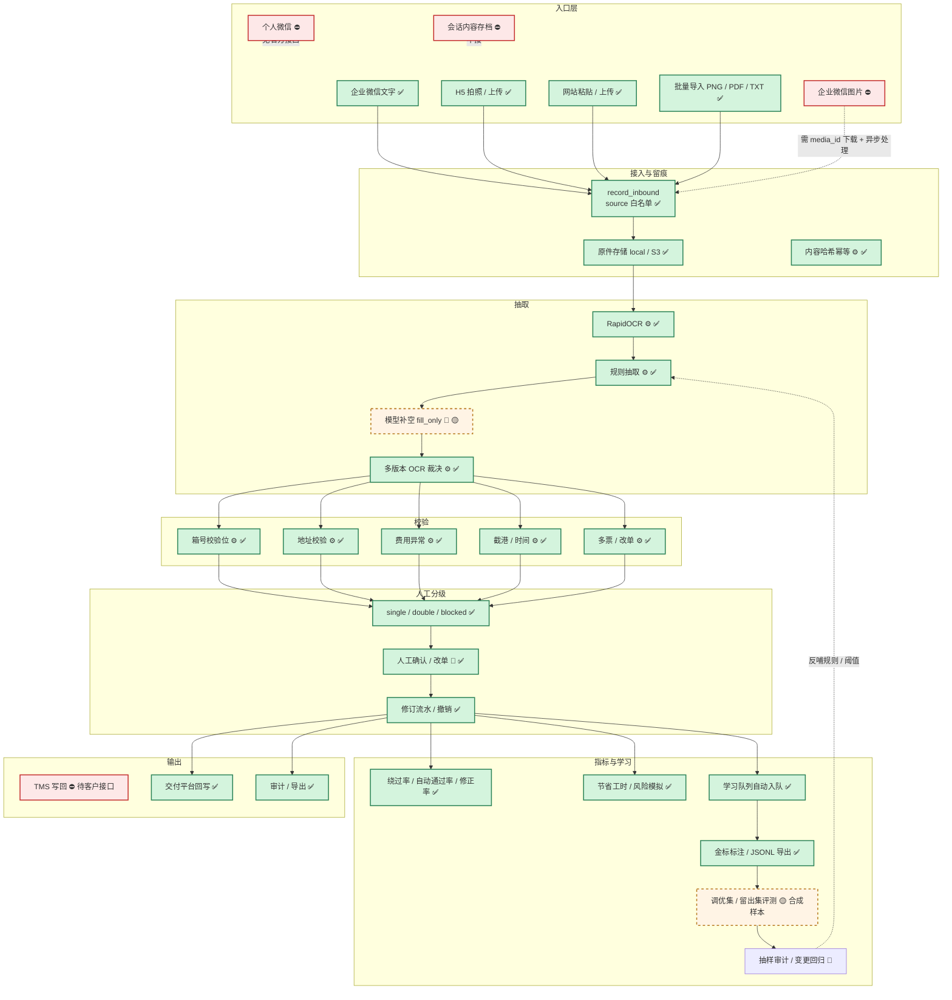
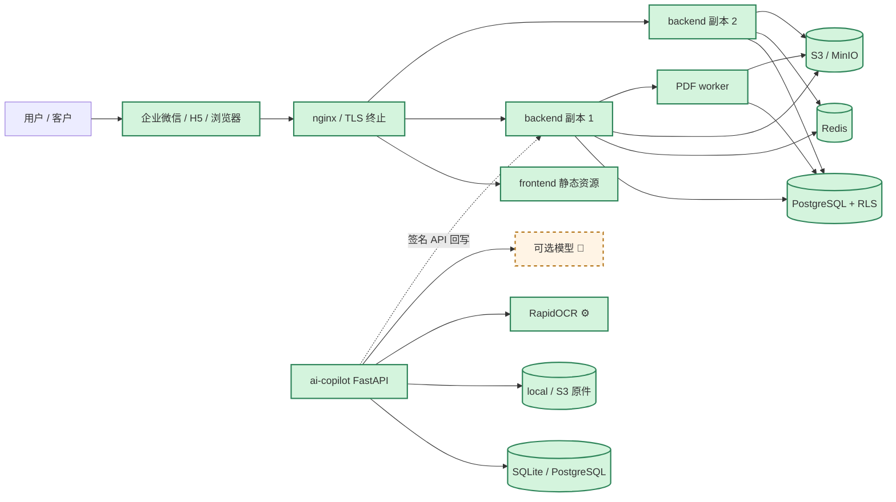
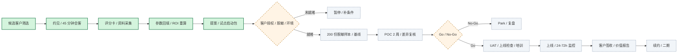

# Enterprise AI 实施全景图

> **版本**：v1.3 ｜ **更新**：2026-11-07 ｜ **基线**：`202549f`（GitHub Actions run #127 四 job 全绿）
>
> **定位**：本文件是实施过程的**单一事实源**。脑图看全局，流程图看顺序，检查表看证据。
>
> **HTML 版**：`实施全景图.html` 由 `scripts/build_impl_map.py` 从本文件生成，**不要手改 HTML**。HTML 会把 `[x]` / `[ ]` 渲染成复选框，并支持“只看未完成 / 只看已完成”。
>
> **GitHub/Gitee 阅读**：表格里的 `[x]` / `[ ]` 可能显示为普通文本，以 HTML 版的复选框为准。
>
> **适用**：诊断平台（`backend` + `frontend`）、AI 托书交付（`ai-copilot`）、多租户与 HA、客户试点、发布运维。

---

## 0. 铁律（摘要；权威与执行细节见 `AGENTS.md` §0）

> **规则权威是 `AGENTS.md`**（Agent 每次会话自动加载）。本节只保留摘要；改规则先改 `AGENTS.md`，再同步本节，避免两处漂移。
> **机械化**：`make preflight`；本地 `make install-hooks`；CI frontend job 运行同一脚本。

1. **图先于改**：任何需求、缺陷、配置、文档变更，开工前先在本图定位受影响节点；提交前再复核一次。
2. **同一提交更新**：代码、文档、状态、证据必须在同一次提交更新。只改代码不改图 = **未完成**。
3. **完成只认证据**：`[x]` 必须有可复现命令、测试记录、CI run、截图/日志或客户签字；口头“应该没问题”不算。
4. **外部项不冒充**：真实客户、真实支付、真实模型、真实 Alertmanager、真实 S3、K8s 预发未验证的，保持 `[ ]` / 🟡，不得写成已完成。
5. **验证串行**：`verify:write` 与 e2e 不并行；合并前 CI 四个 job 全绿（backend / frontend / e2e / docker）。
6. **不包装 AI**：规则引擎、OCR、脚本、人工复核不得写成“大模型能力”；合成样本必须标注“合成”。
7. **无影响也要留痕**：判断本次改动不影响本图时，在提交说明写 `图无影响：<原因>`；否则更新对应节点与“最近核验”。
8. **每次发布更新版本**：更新顶部日期/基线提交、受影响状态、`VERIFICATION.md` 对应章节。
9. **HTML 不手改**：`实施全景图.html` 由 `make impl-map` 生成；CI 与 `make preflight` 会校验与 MD 同步，漂移即失败。

> 违反以上任一条，视为变更未完成，**不得合并、不得推送**。

---

## 1. 图例与状态定义

| 标识 | 含义 | 判定标准 |
|---|---|---|
| ✅ | 已完成且有证据 | 命令通过 / CI 绿 / 有验收记录 |
| 🟡 | 代码完成，外部未验证 | 需要真实客户、真实环境或第三方 |
| ⬜ | 未开始 | 无实现或无证据 |
| ⛔ | 阻塞 / 明确不做 | 依赖缺失或不在本期范围 |
| 🔁 | 持续运行 | 每次发布 / 每周 / 每月执行 |
| 🧍 | 人工确认点 | 必须有人复核或签字 |
| 🤖 | 大模型参与 | 仅限明确标注节点；规则不算 |
| ⚙️ | 规则 / 脚本 / 系统 | 不是 AI |

**进度口径**：`✅` = 代码 + 本地证据；`🟡` = 代码可用但外部证据缺失；`⬜/⛔` = 不能对外承诺。

---

## 2. 总览脑图

---

## 3. 阶段主线：从机会到续约

```mermaid
flowchart LR
  A[客户机会] --> G1{{G1 诊断门禁}}
  G1 --> S1[S1 调研诊断<br/>✅ 代码 / 🟡 真实客户]
  S1 --> G2{{G2 方案门禁}}
  G2 --> S2[S2 方案设计<br/>✅ 代码 / 🟡 真实客户]
  S2 --> G3{{G3 POC 门禁}}
  G3 --> S3[S3 POC 验证<br/>✅ 代码 / ⬜ 真实 POC]
  S3 --> G4{{G4 上线门禁}}
  G4 --> S4[S4 交付实施<br/>✅ 代码 / ⬜ 真实上线]
  S4 --> G5{{G5 价值门禁}}
  G5 --> S5[S5 运营与价值<br/>✅ 代码 / ⬜ 真实数据]
  S5 --> N[续约 / 二期]

  subgraph FOUND[横切能力]
    R1[R1 生产化 ✅]
    R2[R2 方案与多租户 ✅]
    R3[R3 POC 闭环 ✅]
    R4[R4 交付闭环 ✅]
    R5[R5 运营闭环 ✅]
    R6[R6 知识库与 AI 助手 ✅ / 真实模型 ⬜]
  end

  FOUND -.-> S1
  FOUND -.-> S2
  FOUND -.-> S3
  FOUND -.-> S4
  FOUND -.-> S5

  classDef done fill:#d4f4dd,stroke:#2f855a,stroke-width:2px
  classDef partial fill:#fff4e5,stroke:#b7791f,stroke-width:2px,stroke-dasharray:5 5
  classDef todo fill:#f1f5f9,stroke:#94a3b8,stroke-width:2px,stroke-dasharray:3 3
  class S1,S2,R1,R2,R3,R4,R5,R6 done
  class S3,S4,S5,G1,G2,G3,G4,G5 partial
  class N todo
```

**读图要点**

- 五个阶段**代码侧**都已跑通，且各有独立门禁；但“真实客户证据”只有 `🟡/⬜`。
- 门禁不是文档检查，是**系统内的自动校验 + 人工确认**；没有证据不能勾选。
- 真实客户试点必须从 S2 的真实机会点开始，不能拿合成样例直接跳到 S4。

---

## 4. 角色协作泳道

**协作硬规则**

- 客户侧必须有一个**总协调 owner**，负责找齐业务 owner、一线骨干、IT、安全四类人。
- 我方 PM 对计划与验收负责；实施对配置与上线负责；运维对监控与回滚负责；标注/评测对金标质量负责。
- 任何跨角色交接都必须有**书面输入/输出**（模板、确认单、会议纪要、系统记录），不能只在聊天里说。

---

## 5. 变更发布闭环（每次改动都走）

**执行顺序（禁止并行）**

1. 定位节点 → 2. 改代码 → 3. 自检 → 4. `verify` / `verify:write` → 5. e2e（单独跑） → 6. 更新图与证据 → 7. commit → 8. push 双远端 → 9. CI 四 job 全绿 → 10. 部署/灰度 → 11. 监控 → 12. 回滚预案待命。

> `verify:write` 与 e2e 共用测试库/端口，**不能同时跑**；CI 的 e2e 失败会重试 1 次，本地复验不带重试，结果更严格。

---

## 6. AI 托书实施流程（ai-copilot）

**AI 边界（必须能对外讲清）**

- OCR、规则、校验、指标、回写都是**系统能力**，不是大模型。
- 大模型只在 `fill_only`（只补空）介入；无配置或失败自动回退规则。
- 金标标的是**原文写了什么**，不是业务上“应该是什么”；箱号校验失败也不改金标原值。
- 金标评测不是“训练一次就关闭人工复核”的开关；仍需抽样审计、变更回归、新格式准入。
- 企微只自动处理文字消息；图片走 H5/批量导入；“会话内容存档”不做；个人微信无官方接口，不做。

---

## 7. 多租户与 HA 实施流程

### 7.1 部署拓扑（当前实现）

**环境矩阵**

| 环境 | 用途 | 状态 | 命令 / 证据 |
|---|---|---|---|
| 本地 SQLite | 开发 / 演示 | ✅ | `ai-copilot` 默认 |
| 本地 PostgreSQL | 多实例前验证 | ✅ | `DATABASE_URL` + 迁移脚本 |
| Docker Compose 单机 | 演示 / 小规模 | ✅ | `docker compose up -d --build` |
| 多副本 Compose + nginx | HA 演练 | ✅ | `docker-compose.yml` + `soak:replicas` |
| K8s 清单 | 预发/生产模板 | 🟡 | `ops/k8s/` 有清单，未上真实集群 |
| 客户内网离线包 | 私有化交付 | ⬜ | 未实现 |

### 7.2 租户生命周期与运行底座

```mermaid
flowchart LR
  A[供应商自助注册] --> B[组织 + 首管理员]
  B --> C[org_slug 登录]
  C --> D[请求级 org 上下文]
  D --> E[PostgreSQL RLS]
  E --> F[客户 / 项目 / 报告 / 知识库隔离]

  B --> G[14 天试用]
  G --> H[套餐 / 配额]
  H --> I[账单 / 模拟支付 / HMAC 回调]
  I --> J[订阅到期 / 暂停]
  J --> K[平台管理员<br/>租户列表 / 暂停恢复 / 调整套餐]
  K --> L[租户导出 / 删除]

  subgraph INFRA[运行底座]
    N1[Redis 限流 + 会话缓存 ✅]
    N2[S3 / MinIO 对象存储 🟡]
    N3[PDF 队列 SKIP LOCKED ✅]
    N4[多副本 Compose + nginx ✅]
    N5[K8s 清单 / PDB / 迁移 Job 🟡]
    N6[备份 / 恢复 / PITR ✅]
    N7[SLO / 告警 / 值班 🟡]
    N8[滚动发布 / 回滚演练 ✅]
  end

  F --> INFRA
  INFRA --> M[真实客户生产环境 ⬜]

  classDef done fill:#d4f4dd,stroke:#2f855a,stroke-width:2px
  classDef partial fill:#fff4e5,stroke:#b7791f,stroke-width:2px,stroke-dasharray:5 5
  classDef todo fill:#f1f5f9,stroke:#94a3b8,stroke-width:2px,stroke-dasharray:3 3
  class A,B,C,D,E,F,G,H,K,L,N1,N3,N4,N6,N8 done
  class I,J,N2,N5,N7 partial
  class M todo
```

**关键边界**

- 诊断平台是**供应商多租户 SaaS**；ai-copilot 是**单租户客户交付系统**，两者不混为一个应用。
- 多租户隔离靠 PostgreSQL RLS + 受限角色 + 请求级 `app.org_id`，不是只靠代码 `where org_id`。
- 真实支付、发票、自动扣费、K8s 预发、Alertmanager 真实触发、真实 S3 都还没验证。

---

## 8. 客户试点实施流程

**客户侧四类人（缺一不可）**

| 角色 | 找谁 | 投入 | 负责 |
|---|---|---|---|
| 业务 owner | 单证 / 财务主管 | 每周 30 分钟 | 拍板范围与验收、协调样本、主持复盘 |
| 一线骨干 | 单证员 / 财务专员 | 首周 2 小时 + 试用 | 解释单据、确认差异、反馈误判 |
| IT 接口人 | 客户 IT | 首周 2–3 小时 | 环境、账号、接口、网络与权限 |
| 数据 / 安全 | 安全或法务 | 1 次评审 | 脱敏规则、数据边界与合规确认 |

> 第 1 周最关键：样本和验收口径定不下来，后面都白跑；采购/商务不用现在进场。

---

## 9. 逐项检查表（实施团队照此推进）

> 状态说明：`[x]` 有证据；`[ ]` 未完成或外部未验证。每项右侧写证据或命令，禁止空勾。

### 9.1 诊断平台 S1–S5

| ID | 检查项 | 状态 | 证据 / 验收 |
|---|---|---|---|
| S1-01 | 项目、客户、干系人、访谈记录 | [x] | 前端工作台 + 后端 API |
| S1-02 | 痛点、四维盘点、业务流程、机会点与 ROI、风险与局限 | [x] | S1 页面与 API |
| S1-03 | 报告、确认与签收、行业标杆、回收站、审计日志 | [x] | `confirmations` / 审计 API |
| S1-04 | CSV / Excel 批量导入（整批校验、失败回滚） | [x] | 导入接口 + 前端 |
| S1-05 | G1 诊断门禁（客户确认、标杆校准） | [x] | G1 校验规则 |
| S1-06 | 一个真实客户走完 G1 | [ ] | 需真实客户确认记录 |
| S2-01 | 8 张表：方案版本 / 组件 / 集成 / 工作量 / 验收 / 评审 / 报价 | [x] | 迁移 + API |
| S2-02 | 方案工作台、报价页、方案/报价 Word 导出 | [x] | 前端 + 导出 |
| S2-03 | 方案/报价版本对比、客户版脱敏导出 | [x] | 对比接口 + 脱敏 |
| S2-04 | G2 十二项校验（覆盖 / 报价 / 验收 / 阻断 / 负责人 / 人天） | [x] | G2 校验 |
| S2-05 | 6 份交付物：方案书 / 架构 / 集成清单 / PRD / 报价 / 验收标准 | [x] | 模板 + 导出 |
| S2-06 | 一个真实机会点走完 G2 | [ ] | 需真实客户与确认 |
| S3-01 | 5 张表：实验 / 样本 / 运行 / 复核 / 结论 | [x] | 迁移 + API |
| S3-02 | POC 页签、G3 八项校验、POC 报告 Word | [x] | 前端 + 校验 |
| S3-03 | Go / No-Go 联动机会点阶段 | [x] | `go → validated` / `no_go → parked` |
| S3-04 | 一个真实 POC 从设计到结论 | [ ] | 需真实样本、运行记录、客户确认 |
| S4-01 | 6 张表：计划 / 任务 / UAT / 上线检查 / 培训 / 问题变更 | [x] | 迁移 + API |
| S4-02 | G4 十项校验、UAT/上线检查签收联动 | [x] | G4-11 签收 |
| S4-03 | 实施计划 / UAT 报告 / 上线检查表 / 培训材料 Word | [x] | 模板 + 导出 |
| S4-04 | 一个试点真实上线并通过 UAT | [ ] | 需客户环境与签收 |
| S5-01 | 6 张表：指标字典 / 目标 / 快照 / 价值 / 使用 / 续约风险 | [x] | 迁移 + API |
| S5-02 | G5 九项校验、价值报告、续约/二期建议 | [x] | 前端 + 导出 |
| S5-03 | 真实客户运营数据接入与价值口径校准 | [ ] | 需客户数据 |
| S5-04 | 经营洞察：规则引擎生成结论、指标差距与建议动作，Markdown/Word 导出 | [x] | 规则引擎，不调用外部模型 |
| S5-05 | 经营洞察不包装成“大模型能力” | [x] | 对外口径按规则引擎说明 |
| R6-01 | 知识库检索、相似项目推荐、AI 草稿、审批/有效期 | [x] | R6 页面 + API |
| R6-02 | 可选大模型接入，失败回退 `rule-based-v1` | [x] | 配置开关 + 回退 |
| R6-03 | 真实模型联调与提示词评测 | [ ] | 需模型与评测集 |

### 9.2 多租户、HA 与运维

| ID | 检查项 | 状态 | 证据 / 验收 |
|---|---|---|---|
| MT-01 | `organizations` 租户模型（slug / status / settings） | [x] | 迁移 |
| MT-02 | 供应商自助注册 + 首管理员 + 会话 | [x] | `/api/auth/register` |
| MT-03 | 同邮箱多组织按 `org_slug` 登录 | [x] | 登录回归 |
| MT-04 | 平台管理员：租户列表 / 暂停恢复 / 调整套餐 | [x] | `#/tenants` |
| MT-05 | PostgreSQL RLS + 请求级 org 上下文 + 受限角色 | [x] | 破坏性隔离测试 |
| MT-06 | 租户导出 / 删除 / 试用到期 / 配额 | [x] | 生命周期 API |
| MT-07 | 账单生成 / 模拟支付 / HMAC 回调 / 自动续费账单 | [x] | `billing:run` + 测试 |
| MT-08 | 真实支付厂商 SDK、发票、自动扣费 | [ ] | 需商务与支付资质 |
| HA-01 | 请求级数据库连接复用 | [x] | 连接释放测试 |
| HA-02 | PDF 任务 PostgreSQL 队列 + `SKIP LOCKED` worker | [x] | 多实例接管/取消 |
| HA-03 | 对象存储 local / S3 抽象 | [x] | 本地 S3 兼容服务 PUT/GET/DELETE |
| HA-04 | 真实 S3 / 客户对象存储联调 | [ ] | 需客户或云账号 |
| HA-05 | Redis 登录限流 + 会话缓存（未配置回退内存） | [x] | 故障回退演练 |
| HA-06 | 多副本 Compose + migrate job + nginx | [x] | `docker-compose.yml` |
| HA-07 | K8s 清单：滚动升级 / PDB / 迁移 Job / worker | [x] | `ops/k8s/` |
| HA-08 | K8s 预发集群真实滚动发布 | [ ] | 需集群 |
| HA-09 | 多副本压测（约 2000 QPS、P95 15ms）与故障演练 | [x] | `npm run soak:replicas` |
| HA-10 | 逻辑备份恢复演练（含 RLS 权限修复） | [x] | `make drill-restore` |
| HA-11 | PITR 时间点恢复演练 | [x] | `make drill-pitr` |
| HA-12 | 滚动发布与回滚演练 | [x] | `npm run drill:rollout` |
| HA-13 | 告警路由/抑制演练（17 条告警、9 个场景） | [x] | `npm run drill:alerts` |
| HA-14 | SLO / 告警规则 / Grafana / 值班模板 | [x] | `ops/slo.md`、`ops/alerts.yml` |
| HA-15 | 真实 Alertmanager 触发与值班复盘 | [ ] | 需接收端与值班表 |
| HA-16 | 真实值班表 `ops/oncall.yml` | [ ] | 含真实联系人，不提交仓库 |
| HA-17 | 租户级品牌 / 默认行业 / 保留策略配置 | [ ] | 未实现 |
| HA-18 | 交付系统组件化与云上/内网安装编排 | [ ] | 未实现 |

### 9.3 AI 托书（ai-copilot）

| ID | 检查项 | 状态 | 证据 / 验收 |
|---|---|---|---|
| AI-01 | 四角色鉴权 + 会话撤销 + 操作者记录 | [x] | 91 端点鉴权 + `actor` |
| AI-02 | 9 项阈值运行时可调 | [x] | `/settings` + `settings.json` |
| AI-03 | 原件存储 + 回读 | [x] | `runs.source_file` + `/api/files/` |
| AI-04 | 批量取消 / 续跑 | [x] | `POST /api/batches/{id}/cancel` |
| AI-05 | 撤销确认 / 修订流水 | [x] | `run_revisions` |
| AI-06 | 企业微信文字消息 + 加解密安全模式 + 分条录入（分条/逐条/完成/确认/取消） | [x] | 官方向量验证 + 分条流程 |
| AI-07 | 企业微信图片消息 | [ ] | 需 media_id 下载 + 异步处理 |
| AI-08 | 企业微信应用认证 + 固定域名 | [ ] | 当前临时隧道，重启会变 |
| AI-09 | H5 拍照 / 上传（系统文件选择器/相机，不做网页内实时预览） | [x] | `source=h5-upload` |
| AI-10 | 网站粘贴 / 上传 | [x] | `source=web` / `web-upload` |
| AI-11 | 批量导入 PNG / PDF / TXT（200 文件、单文件 ≤10MB） | [x] | 默认 `use_llm=false&mask=true` |
| AI-12 | 所有入口写 `inbound`，保证绕过率分母完整 | [x] | H5 / 网页 / 批量 / 企微均验证 |
| AI-13 | OCR（RapidOCR）+ 规则抽取 + 多版本裁决 | [x] | 验收记录 |
| AI-14 | 模型 `fill_only` 补空 + 失败回退 | [x] | 配置开关 + 回退 |
| AI-15 | 箱号校验位 / 地址 / 费用 / 截港 / 多票 / 改单 | [x] | 规则与测试 |
| AI-16 | 分级审批 single / double / blocked | [x] | 风险字段判定 |
| AI-17 | 人工确认 / 改单 / 反馈留痕 | [x] | `feedback` / `confirmed_by` |
| AI-18 | 指标：绕过率 / 自动通过率 / 修正率 / 节省工时 / 风险模拟 | [x] | 指标中心 |
| AI-19 | 学习队列自动入队（低置信 / 阻断 / 容错 / 多票 / 人工确认） | [x] | `learn_queue` |
| AI-20 | 标注工作台：原文、系统值、置信度、保存金标、跳过、导出 JSONL | [x] | `/learn` |
| AI-21 | 学习队列按来源/批次筛选，统计卡同步；无来源用 `__none__` | [x] | `/api/learn/filters` + 实测批次 |
| AI-22 | 金标评测：调优集 20 / 留出集 8 / 规则 / 模型 / 合并（当前为合成样本） | [x] | `make eval`；98.7% 字段 / 87.5% 整单，不可对外当真实准确率 |
| AI-23 | 真实脱敏托书 20–50 份 + `gold.csv` 离线评测 | [ ] | `samples/real/` 当前 0 份 |
| AI-24 | 批量结果 → 金标导出/比对自动打通 | [ ] | 当前需手工导出 |
| AI-25 | 回写交付平台（POC 运行记录，幂等 + 重试） | [x] | 发件箱 + 重试 |
| AI-26 | TMS 写回 | [ ] | 需客户 TMS 接口文档 |
| AI-27 | 抽样审计 / 变更回归 / 新格式准入 | 🔁 | 每次模型/规则/格式变更 |
| AI-28 | 个人微信 / 会话内容存档 | ⛔ | 明确不做 |

### 9.4 发布、验证与安全

| ID | 检查项 | 状态 | 证据 / 验收 |
|---|---|---|---|
| CI-01 | 后端 `typecheck` + `verify` | [x] | 17/17 |
| CI-02 | 后端 `verify:write` | [x] | 51/51，串行 |
| CI-03 | 前端 `typecheck` + 单测 + build | [x] | 单测 13 项 |
| CI-04 | Playwright e2e | [x] | 25/25 |
| CI-05 | Docker Compose smoke | [x] | GitHub Actions docker job |
| CI-06 | ai-copilot smoke | [x] | 15/15 |
| CI-07 | GitHub Actions 四 job | [x] | run #126 全绿 |
| CI-08 | 推送 GitHub + Gitee | [x] | `e87e65d` |
| CI-09 | 迁移只前进、不重写历史迁移 | 🔁 | `db/migrations` |
| CI-10 | 发布/回滚演练 | [x] | `drill:rollout` |
| CI-11 | 实施全景图 HTML 与 MD 同步校验 | [x] | run #126 前端 job 通过 |
| CI-12 | 提交预检：节点 ID / 图无影响 / HTML 同步，本地 hook 与 CI 共用 | [x] | `scripts/preflight.py` + `make preflight` |
| SEC-01 | scrypt 密码、会话撤销、登录失败锁定 | [x] | 安全自检 |
| SEC-02 | 密码策略 + 最近 5 次不可复用 | [x] | 用户管理 |
| SEC-03 | 请求 ID + 结构化访问日志（脱敏） | [x] | 日志中间件 |
| SEC-04 | 审计日志 / 软删除 / 回收站 | [x] | 审计 API |
| SEC-05 | 依赖漏洞基线 | 🟡 | 后端生产 5 moderate；含开发 9；前端 0 |
| SEC-06 | 外部安全评审 / 渗透测试 | [ ] | 未做 |
| DOC-01 | `VERIFICATION.md` 记录本轮实测 | [x] | 5.5 / 5.6 / 5.7 节 |
| DOC-02 | `TODO.md` / `AUTOPILOT_QUEUE.md` 状态同步 | 🔁 | 每次勾选 |
| DOC-03 | 本图状态与证据同步 | 🔁 | **铁律** |
| DOC-04 | 运维手册 / 部署文档更新 | [x] | `OPERATIONS.md` / `DEPLOY.md` |
| DOC-05 | 对外材料：中文、原生可编辑、区分大模型/规则/人工、合成数据标注、不整页图片 | 🔁 | 每份 PPT/报告外发前逐项检查 |

### 9.5 真实客户试点外部输入（全部需要客户证据）

| ID | 输入 | 状态 | 验收证据 | 负责人 |
|---|---|---|---|---|
| EXT-01 | 客户授权与项目范围确认 | [ ] | 签字 / 邮件 / 确认单 | 客户项目负责人 |
| EXT-02 | 数据处理与脱敏约定 | [ ] | 数据清单 + 脱敏规则 | 客户安全/法务 + 我方 |
| EXT-03 | 真实机会点 1 个 | [ ] | 机会点编号、访谈记录、基线 | 顾问 |
| EXT-04 | 真实样本（POC） | [ ] | 来源、数量、字段、访问状态 | 客户业务 |
| EXT-05 | 接口人与排期 | [ ] | 周会节奏、评审窗口 | 客户 PM |
| EXT-06 | 试点环境 | [ ] | 域名、网络、账号、回滚窗口 | 客户 IT / 我方运维 |
| EXT-07 | 验收口径 | [ ] | 指标、目标、测量方法、责任人 | 双方 |
| EXT-08 | 200 份脱敏托书 + `gold.csv` | [ ] | 样本清单 + 标注记录 | 客户一线 + 标注 |
| EXT-09 | POC 运行记录 + 人工复核 | [ ] | run_no、配置、指标、复核人 | 我方 + 客户 |
| EXT-10 | UAT 报告 + 上线检查表签收 | [ ] | 客户签字 | 客户业务 owner |
| EXT-11 | 上线后 24–72h 监控记录 | [ ] | 错误率、P95、导出失败 | 我方运维 |
| EXT-12 | 价值报告 + 续约/二期建议 | [ ] | 可追溯快照/价值记录 | 我方 + 客户 |

### 9.6 门禁证据清单

| 门禁 | 必须有什么 | 当前状态 |
|---|---|---|
| G1 诊断 | 客户确认记录、标杆校准状态 | ✅ 规则可用；⬜ 真实客户 |
| G2 方案 | 方案覆盖、集成、工作量/报价、验收标准、阻断、负责人 | ✅ 规则可用；⬜ 真实机会点 |
| G3 POC | 假设、样本、基线、运行、复核、结论 | ✅ 规则可用；⬜ 真实 POC |
| G4 上线 | UAT、P0/P1、回滚、监控、培训、签收 | ✅ 规则可用；⬜ 真实上线 |
| G5 价值 | 指标、目标、实际、来源、确认、续约 | ✅ 规则可用；⬜ 真实数据 |

> 门禁通过 = 系统校验通过 + 人工确认留痕。只有系统校验没有客户确认，不能算真实通过。

### 9.7 运行节奏（持续项）

| 周期 | 动作 | 负责 | 证据 |
|---|---|---|---|
| 每次改动 | 读图定位 → 改代码 → 串行验证 → 同提交更新图/证据 | 开发者 | commit + CI |
| 每日 | 健康检查、告警处置、失败批次/失败任务清理 | 运维 | 监控面板 + 日志 |
| 每周 | 清学习队列、抽样审计、客户周会、风险登记册更新 | PM + 标注 + 客户 owner | 周报 + 标注记录 |
| 每月 | 备份恢复抽检、权限/会话复核、配额与账单核对 | 运维 + 平台管理员 | 演练记录 + 账单 |
| 每季度 | 安全评审、容量/成本复盘、SLA 与告警阈值校准 | 技术负责人 | 评审纪要 |
| 每次模型/规则/格式变更 | 金标回归 + 抽样审计 + 新格式准入 | 标注/评测 | `make eval` + 评测报告 |

---

## 10. 角色 RACI（谁负责、谁拍板）

> R = 执行；A = 最终负责/拍板；C = 需咨询；I = 需知会。

| 活动 | 客户决策人 | 客户业务 owner | 客户一线 | 客户 IT/安全 | 销售/顾问 | 我方 PM | 实施/交付 | 运维 | 标注/评测 |
|---|---|---|---|---|---|---|---|---|---|
| 客户授权 / 预算 | A | C | I | C | R | I | I | I | I |
| 范围 / 验收口径 | A | R | C | C | C | R | C | I | I |
| 样本 / 脱敏 | I | A | R | C | I | C | C | I | C |
| G1 诊断 | I | A | C | I | R | C | I | I | I |
| G2 方案 / 报价 | A | C | I | I | R | R | C | I | I |
| POC 设计与复核 | I | A | R | C | C | R | R | I | C |
| 上线 / UAT | A | R | R | C | I | A | R | C | I |
| 监控 / 告警 | I | I | I | C | I | C | C | R/A | I |
| 金标 / 评测 | I | C | R | I | I | I | C | I | R/A |
| 价值报告 / 续约 | A | R | C | I | R | C | C | I | I |

**硬规则**

- 每行只能有一个 `A`；没有 `A` 的活动不允许启动。
- 客户侧 `A` 不落地时，项目只能停在“方案/样例”，不能进入“真实试点/上线”。
- 标注/评测的 `A` 不能由写规则/提示词的人兼任，避免自己标自己。

---

## 11. 变更影响矩阵（提交前对照）

| 改动类型 | 必须更新 | 必须跑 |
|---|---|---|
| API / 数据模型 | 本图 6/7 节、OpenAPI、`VERIFICATION.md` | `verify` + 迁移检查 |
| 前端页面 / 交互 | 本图 3/6 节、e2e 用例 | `typecheck` + e2e |
| 规则 / 阈值 | 本图 6 节、运维手册阈值表 | 规则单测 + smoke |
| 模型 / 提示词 | 本图 6 节、评测集、合成标注 | `make eval` + 金标回归 |
| 企微 / H5 / 批量入口 | 本图 6 节、试用指南 | 入口实测 + inbound 校验 |
| 多租户 / RLS | 本图 7 节、迁移、隔离测试 | `verify:write` + RLS 破坏性测试 |
| CI / 部署 / 运维 | 本图 5/7 节、`DEPLOY.md`、`OPERATIONS.md` | 对应演练脚本 |
| 只改文档 | 若改变了状态/承诺，更新本图与证据 | 链接检查 |
| 无影响 | 提交说明写 `图无影响：<原因>` | 至少跑 smoke |

---

## 12. 每次改动如何复核本图（5 分钟版）

1. **定位**：在 §9 找到对应 ID（如 `AI-21`）；没有就新增一行。
2. **判定**：是代码完成（✅）、外部未验证（🟡）、未开始（⬜）还是阻塞（⛔）。
3. **改图**：更新节点文字、状态、证据列；必要时改 §3–§8 的 Mermaid 图。
4. **同步**：更新 `VERIFICATION.md` 对应章节；涉及待办则更新 `TODO.md`。
5. **验证**：按 §11 跑命令；确认没有并行跑 `verify:write` 与 e2e。
6. **提交**：commit message 带节点 ID，例如 `feat(copilot): 学习队列筛选 [AI-21]`。
7. **推送**：双远端；等 CI 四 job 全绿。
8. **复盘**：发布后 24 小时内确认线上与图一致；不一致则回滚或补图。

---

## 13. 维护记录

| 版本 | 日期 | 基线 | 变更 |
|---|---|---|---|
| v1.3 | 2026-11-07 | `202549f` | 铁律可执行化：preflight 脚本、Git hooks、CI 校验；规则权威归位 `AGENTS.md` |
| v1.2 | 2026-11-07 | `e87e65d` | 复核 v1.1 改动并推送；run #126 四 job 全绿 |
| v1.1 | 2026-11-07 | `e4e2b96` | 新增 CI 同步校验；run #125 四 job 全绿；CI-11 关闭 |
| v1.0 | 2026-11-07 | `c3b37ac` | 首版：脑图、阶段主线、角色泳道、发布闭环、AI 托书、多租户、客户试点、逐项检查表、RACI、铁律 |

> 下次复核：**每次提交**；至少每周一次全量核对。发现图与代码/证据不一致，先修图再继续开发。
